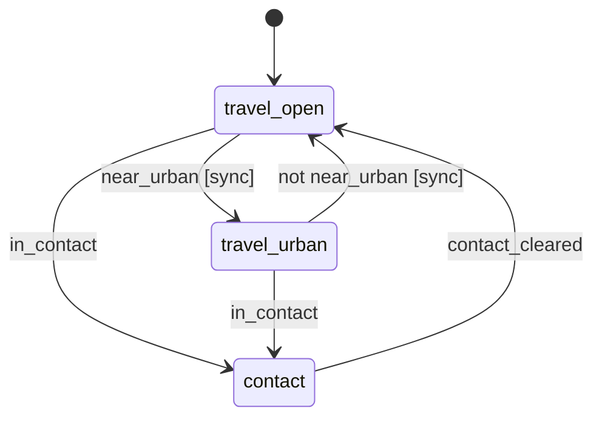

# Falcon v2 生成层：分部熟悉格式 + 确定性组合（设计稿）

状态：**已确认并实施（v2.0，2026-10-18）**　日期：2026-10-14（设计）、2026-10-18（实施）
相关：`docs/design/tactical-falcon-v1.md`（v1 设计）、`docs/design/tactical-behavior-ir-v1.md`（IR）

## 0. 背景与目标

v1 让模型直接以 JSON 分段输出 IR。armor-eval-03 在线评测（v2→v3）暴露的问题：

- 模型不熟悉 IR 写法：表达式、组件操作数、黑板声明等写法错误占大头（v3 26 个错误中 14 个）；
- 分段生成需要跨段引用 ID，状态命名、协同归属等一致性错误无法靠局部修复解决；
- 修复轮整段重写，错误数来回波动。

调研结论（SPEAC/Eudoxus、LLMLift、NatSQL、BTGenBot 系列、Code as Policies）：
**让模型用它训练中常见的格式表达，由确定性的编译器把这些格式组合成目标表示；模型不擅长推断、规则能确定的内容由代码补全；出错时局部补洞而不是整体重写。**

目标：

1. 模型面对的是"一份战术稿"，各部分分别用 YAML、Mermaid、Python 表达式、BehaviorTree.CPP XML 书写；
2. Falcon 编译器把战术稿解析、链接、补全为现有 IR；**IR、校验器、后端全部不变**；
3. IR 校验错误能回指到战术稿中的具体块和行，修复时只重写出错的块或片段；
4. 证据规范化（F1）、需求拆解（F2）、门槛（F0）、basis 强制规则、确认流程保持不变。

非目标：改 IR 语义；让模型直接生成后端代码；执行模型写的任何代码。

## 1. 总体结构

```
需求 + 证据包
   │
   ▼  （模型，分 3 次调用，见 §4）
战术稿 tactic_sheet.md ── 多个带标签的代码块
   │
   ▼  Falcon 编译器（全部确定性代码）
 ① 分块解析   yaml / mermaid / python-ast / xml，各自的解析器，容错
 ② 链接       全局符号表：角色、状态、参数、条件、树、协同生成的 ID
 ③ 推断补全   行为、黑板声明、资源占用、兜底转换、同步标记、想定初值……
 ④ 生成 IR    behavior_spec.yaml + 源码映射 source_map.json
   │
   ▼  现有 IR 校验（L1/L2/L3）
 ⑤ 错误回指   IR 路径 → 战术稿块与行号
 ⑥ 局部修复   无法解析/无法链接的部分留"空洞"；只把出错块（或空洞）发回模型
```

## 2. 各部分的格式

| 战术稿块 | 格式 | 内容 | 选择理由 | 解析方式 |
| --- | --- | --- | --- | --- |
| `yaml model` | YAML | 角色与组件、编队几何、协同、参数（含 basis）、假设 | 配置文件格式，语料极多 | `yaml.safe_load` |
| `mermaid` | Mermaid `stateDiagram-v2`，每个角色一张 | 状态、转换、条件名、同步标记 | 模型经常写 Mermaid；IR 已有 Mermaid 后端，可直接对照 | 受限行文法（自写，约 100 行） |
| `python conditions` | Python 赋值语句（仅表达式） | 条件定义 | Python 语料最丰富；比较、布尔、函数调用都是原生写法 | `ast.parse`，白名单节点，**不执行** |
| `xml`（每个角色一个） | BehaviorTree.CPP v4 XML | 每个状态一棵行为树；叶子是动作或条件 | 行为树事实标准格式；BTGenBot 等工作均采用 | `xml.etree`（禁用实体），白名单节点 |
| `yaml verification` | YAML | L2 测试、L3 想定 | 同上 | `yaml.safe_load` |
| `yaml basis` | YAML | 非兜底转换、行为规则的依据（参数、编队、协同的依据写在 model 块内） | 同上 | `yaml.safe_load` |

### 2.1 `yaml model`

```yaml
roles:
  platoon_leader: {count: 1, platform: ground_vehicle, mover: route_following_ground,
                   sensors: {sensor_0: optical}, comms: {radio: radio}}
  wingman:        {count: 3, platform: ground_vehicle, superior: platoon_leader,
                   mover: route_following_ground, comms: {radio: radio}}
parameters:
  column_interval: {value: 50 m, range: [10 m, 300 m], basis: user_specified, implements: [rq_05]}
  urban_transition_distance: {value: 300 m, basis: inferred, evidence: [ev_64243d5a36],
                              rationale: "资料要求接近城区前完成队形转换"}
formations:
  column:
    slots:                       # 长车在原点，不列入
      "wingman[0]": {forward: -1 * column_interval, right: 0 m}
      "wingman[1]": {forward: -2 * column_interval, right: 0 m}
      "wingman[2]": {forward: -3 * column_interval, right: 0 m}
    tolerance: station_tolerance
coordination:
  platoon_follow: {pattern: leader_follower, leader: platoon_leader, followers: wingman,
                   formation_from: platoon_leader.current_formation}
  contact_report: {pattern: report_and_wait, reporter: wingman, receiver: platoon_leader, ack_timeout: 30 s}
  bounding:       {pattern: bounding_overwatch, bounding: [platoon_leader, "wingman[0]"],
                   overwatch: ["wingman[1]", "wingman[2]"], bound_distance: bound_distance,
                   active_when: in_contact, standoff: standoff_distance}
```

约定：数值写成 `"50 m"` 这样的"数 + 单位"字符串（由现有单位模块解析）；参数在其他块中直接按名字引用；`-1 * column_interval` 这种乘法由编译器转成 `parameter_ref + scale`。

### 2.2 `mermaid`（每个角色一张）



约定：
- 同一状态的多条转换**按书写顺序决定优先级**（先写的优先），编译器换算成 priority；
- 标签只写条件名或 `not 条件名`（条件统一在 Python 块定义，避免 XML/Mermaid 中的特殊字符问题）；
- `[sync]` 表示由协同同步给跟随角色；编译器查找该角色作为 leader/initiator 的协同并写入 `synchronize_with`；
- 兜底的"留在本状态"转换由编译器补，不需要写。

### 2.3 `python conditions`

```python
near_urban = terrain.distance_to("urban") <= urban_transition_distance
in_contact = track.nearest_hostile_range <= contact_range or bb.contact_reported
contact_cleared = track.hostile_count == 0 and time_in_state() >= contact_hold_time
mover_ok = mover.available
```

操作数名称空间由操作数目录自动生成（`terrain`、`track`、`mover`、`sensor("sensor_0")`、`comm("radio")`、`self`、`formation`、`team`、`bb`、`leader.bb`、目录函数）。参数直接用名字；数值字面量写 `50 * m` 或 `q("50 m")`。只允许比较、`and/or/not`、属性访问和白名单函数调用，其他 AST 节点一律变成空洞。

### 2.4 `xml`（每个角色一个，BehaviorTree.CPP v4）

```xml
<root BTCPP_format="4">
  <BehaviorTree ID="travel_open">
    <Sequence>
      <SetBlackboard key="current_formation" value="wedge"/>
      <Coordination use="platoon_follow.announce_formation"/>
      <FollowRoute route="main_route" speed="travel_speed_open"/>
    </Sequence>
  </BehaviorTree>
  <BehaviorTree ID="contact">
    <ReactiveFallback>
      <SubTree ID="bounding.tree"/>
      <Halt/>
    </ReactiveFallback>
  </BehaviorTree>
</root>
```

约定：
- `BehaviorTree ID` 等于 Mermaid 中的状态名，即为该状态的树；也可以定义其他树供 `SubTree` 复用；
- 叶子：动作目录中的动作写成驼峰节点（`FollowRoute`、`KeepStation`……），端口即动作参数；`<Condition name="near_urban"/>` 引用 Python 中定义的条件；`<Coordination use="协同.生成行为"/>` 和 `<SubTree ID="协同.tree"/>` 引用协同生成的内容；
- 控制节点沿用 BT.CPP 标准名（`Sequence`、`ReactiveSequence`、`Fallback`、`ReactiveFallback`、`Parallel`、`Inverter`、`Repeat`、`ForceSuccess`），与现有 `btcpp_xml` 后端的映射表互逆；
- 端口取值：参数名 → `parameter_ref`；`{key}` → 黑板；`"50 m"` → 数量；其余按端口类型当作 ID。

### 2.5 `yaml verification` 与 `yaml basis`

测试只写 `given`（角色、状态、几个观测值）和 `expect`（下一状态、下达的动作）；想定只写路线、地形区域、事件和期望。初始位置、编队初值、`traces_to` 等由编译器补。basis 块按 `角色: 起始状态 -> 目标状态` 为转换写依据。

## 3. 组合机制（编译器）

### 3.1 符号表与链接

所有块解析后进入一张全局符号表：

| 符号 | 定义处 | 被引用处 |
| --- | --- | --- |
| 角色、实例 `wingman[i]` | model.roles | 编队、协同、想定、basis |
| 参数 | model.parameters | 编队、协同、条件、XML 端口 |
| 条件 | python | Mermaid 标签、XML `Condition`、协同 `active_when` |
| 状态 | Mermaid | XML `BehaviorTree ID`、测试、basis |
| 树 | XML | Mermaid（同名）、`SubTree` |
| 协同生成的 ID | 由现有协同展开代码计算 | XML `Coordination` / `SubTree`、条件 |

链接失败（未定义名字、不属于该角色的生成行为等）不直接报错，而是标成空洞，并记录"候选名字"（编辑距离最近的已定义符号）。

### 3.2 推断补全（由代码负责，不让模型写）

| 内容 | 规则 |
| --- | --- |
| IR 行为 | 每个动作叶子生成一个单动作行为；资源占用取自动作目录；完成条件按动作类型取默认（`follow_route` → 路线完成；瞬时动作 → 立即成功） |
| IR 条件 ID | Python 中的变量名 |
| 黑板变量声明 | 从所有 `bb.x`、`SetBlackboard key=x` 推断，类型取首次赋值的类型 |
| 兜底转换 | 每个状态末尾补"留在本状态" |
| `synchronize_with` | 由 `[sync]` 和协同定义推出；跟随角色缺少同名状态时报**骨架级**错误 |
| 编队槽位 | 由 `-k * 参数` 推出 `parameter_ref + scale` |
| 想定初值 | 长车在路线起点，跟随者按初始编队槽位放置 |
| 测试下达动作 | 由叶子节点名换算为动作名 |
| issue_policy | 按动作目录默认 |

### 3.3 源码映射与错误回指

编译时记录每个 IR 元素来自战术稿的哪个块、哪一行（`source_map.json`）。IR 校验诊断经映射后变成"块 + 行 + 原文片段 + 原因"，审查报告和修复提示都使用这种形式。

### 3.4 局部修复（补洞）

1. 解析/链接阶段产生的空洞和 IR 校验错误，按所属块分组；
2. 每个出错块：把该块原文（空洞处标 `???` 并附候选名）连同错误说明发给模型，**只要求重写这一块**；其他块原样保留并作为上下文；
3. 每轮重新编译和校验；错误数不下降就回滚到最好的一轮（沿用 v1 的回滚）；
4. 跨块的结构性问题（如跟随角色缺少同名状态）回到 Mermaid 块修复，不在 XML 层修补。

## 4. 生成流程

| 调用 | 模型写什么 | 能看到什么 |
| --- | --- | --- |
| 1. 结构稿 | `yaml model` + 每个角色的 `mermaid` | 需求、条款、证据摘要、动作/协同目录、示例 |
| 2. 控制稿 | `python conditions` + 每个角色的 `xml` + `yaml basis` | 结构稿原文、编译器给出的符号清单（可引用的名字及其归属角色） |
| 3. 验证稿 | `yaml verification` | 前两稿原文、符号清单 |

每次调用后立即编译，前一稿的错误先修好再进入下一稿。三稿都是纯文本（Markdown 代码块），不再使用 JSON 模式或结构化输出。可配置为一次生成整份战术稿，用于和三次调用做对比。

`tactic_sheet.md` 作为模型包的一部分保留，人工审查和手工修改也可以直接改这份文件，然后用 `falcon compile` 重新生成 IR。

## 5. 安全

- 只做解析，不执行：Python 用 `ast.parse` 后遍历白名单节点；XML 用禁用外部实体的解析器；YAML 用 `safe_load`；
- 限制每块大小和嵌套深度；
- 战术稿和源码映射不包含本地资料原文，只引用证据 ID（与 v1 一致）。

## 6. 渐进实施与验证门槛

| 阶段 | 内容 | 门槛（同一需求同一模型，各跑 10 次取平均） |
| --- | --- | --- |
| P0 | 只把控制段的树改为 BT.CPP XML，其余保持 v1；做 A/B 对比 | XML 组的树相关错误不高于 JSON 组 |
| P1 | 条件改为 Python 表达式 | 表达式类错误（IR002 等）显著下降 |
| P2 | `yaml model` + Mermaid + 推断补全，完整战术稿与三次调用 | 首稿 L1 错误数、修复轮数、调用次数优于 v1 |
| P3 | 源码映射与补洞式局部修复 | 修复轮错误数单调下降；≤3 轮通过率 |

评测集：装甲排（armor-eval-03）之外，新写 2 条不同类型的需求（如步兵班交替跃进、两机编队巡逻），防止只对一个例子调优。v1 生成路径保留，用开关切换，作为对照基线。

## 7. 风险与待定问题

1. **Mermaid 标签的书写偏差**：模型可能写出条件表达式而不是条件名。对策：标签若能被 Python 表达式解析，就自动提升为匿名条件。
2. **XML 中的特殊字符**：条件只按名字引用，不在 XML 属性里写比较运算，避免 `<`、`&` 转义问题。
3. **"动作即行为"的粒度**：带前置条件、超时、多动作的复杂行为，用子树（`ReactiveSequence` + `Condition` + 动作）表达；是否需要 `<Behavior>` 自定义节点承载超时等属性，P2 时根据实际需求决定。
4. **basis 的位置**：参数、编队、协同的依据写在 model 块内；转换的依据单独成块，可能被模型遗漏，由编译器检查并在修复时提示。
5. **小模型的长输出**：控制稿包含多个角色的 XML，可能较长；必要时按角色拆分调用。

## 8. 待确认

1. 是否采用三次调用（结构稿、控制稿、验证稿）作为默认，同时保留"一次生成整份战术稿"的选项？
2. 状态机用 Mermaid `stateDiagram-v2`（推荐），还是用 YAML 转换表？
3. 是否按 P0 → P3 渐进实施，先做 P0 的 A/B 对比？


## 9. 实现说明（2026-10-18，v2.0）

用户确认按本稿迭代。§8 的三项按推荐方案执行：

- 默认三次调用，保留一次生成整份战术稿的选项；
- 状态机用 Mermaid；
- P0–P3 一次实现。

原因：编译器是确定性代码，可以离线完整测试；A/B 门槛需要在线运行，因此改为整体对比 v1 与 v2，v1 保留为对照。

**切换**：

```text
python -m afsim_research_agent.falcon draft <请求> --generator v2 [--sheet-calls 1]
```

也可以在请求文件中写 `generator: v2`。默认仍是 v1，等在线对比后再改默认值。

**代码**：`src/afsim_research_agent/falcon/sheet/`

| 文件 | 内容 |
| --- | --- |
| `blocks.py` | 分块、行号、空洞（`SheetProblem`：块、行、原因、候选名；警告不进入修复） |
| `values.py` | "50 m" 数量、basis 简写、`-2 * 参数` 距离 |
| `pyexpr.py` | Python 条件 → IR 表达式：`ast.parse`，白名单，不执行 |
| `mermaid.py` | `stateDiagram-v2` 子集 |
| `btxml.py` | expat 解析，拒绝 DOCTYPE 和实体，保留行号 |
| `compiler.py` | 链接与推断补全，输出 v1 的骨架和分段记录加源码映射；之后的组装、basis 强制、自动修正、IR 校验、审查、确认与 v1 共用 |
| `locate.py` | IR 诊断路径 → 块与行 |
| `prompts.py` | 结构稿、控制稿、验证稿、一次生成、补洞提示词（`falcon-sheet-2026.10.1`） |
| `generate.py` | 三次调用、阶段内补洞、整体校验后的分块修复与回滚 |
| `recompile.py` | `falcon compile` |

**与本稿的差异和补充**：

| 项 | 做法 |
| --- | --- |
| 条款追溯 | 写在 `yaml model` 的 `implements: {条款: [元素]}` 与 `out_of_scope: {条款: 原因}`；元素可以是角色、`角色.状态`、编队、协同、参数或 `"角色: a -> b"` 转换。未列出的条款是空洞 |
| 状态图中的条件 | 结构稿可以先用条件名，控制稿必须定义；未定义的条件记为 Python 块的空洞，转换本身保留（避免 basis 块等连带出错） |
| 转换 ID / 优先级 | `<角色>_<起始>_to_<目标>`；同一状态按书写顺序 100、90、80…；兜底 `<角色>_<状态>_stay`，优先级 0 |
| `terrain.class` | `class` 是 Python 关键字，编译前自动改写为 `class_` |
| 行为 | 每个动作叶子生成一个行为，相同写法复用同一个；完成条件按动作取默认（走完路线、到达、立即完成、持续运行）；需要机动的动作自动加"机动部件可用"的前置与失败条件；外部动作默认 `once_per_activation`，`keep_station` 每周期下达 |
| 行为覆盖 | 叶子节点可写 `_successIf`、`_failureIf`、`_while`（前置条件），值为条件名或 Python 表达式；`timeout="30 s"` |
| 黑板 | 从 `SetBlackboard`、`bb.x`、`formation_from` 推断变量和类型；默认值取初始状态树中第一次写入的值 |
| 想定 | `route`、`terrain.regions` 写成 `x: [x0, x1]`；长车放在路线起点、朝向第二个航点；跟随者按长车编队变量的默认值或第一个含它的编队放置；`traces_to` 由期望中的编队、协同消息和角色状态自动补充 |
| 测试 | `transition: "a -> b"`，跟随角色被同步时换算为协同生成的转换 ID；动作写节点名（`FollowRoute`） |
| 错误回指 | 协同生成元素被错误角色使用的错误，回指到使用它的那个角色 XML 的行，不是协同定义 |
| 修复 | 结构稿、控制稿各最多 2 轮阶段内补洞；整体校验后按块修复，最多 `--max-repair` 轮；评分为（能否加载, 空洞数 + IR 错误数），变差时回滚到最好的一轮 |
| 文件 | 模型包新增 `tactic_sheet.md`、`source_map.json`；审查报告新增 §9；`falcon_trace.json` 记录 `generator`、`sheet`（块、空洞、提示） |
| `falcon compile` | 修改战术稿后重新生成 `behavior_spec.yaml`（不调用模型）；`confirmations.yaml` 重写时保留已填写的决定 |

**验证**：

- **示例战术稿**：装甲排示例写成战术稿（`examples/armor_platoon_terrain_formation/tactic_sheet.md`，约 230 行，对应手写 IR 634 行），编译后 L1 无错误，L2 11/11，L3 3/3。
- **单元测试**：`tests/unit/falcon/test_falcon_sheet.py` 共 10 项：
  - 解析：Python、Mermaid、XML 安全、分块行号；
  - 示例战术稿编译通过；
  - 空洞的行号与候选名；
  - 端到端三次调用；
  - 只修出错的块：条件缺失在控制稿阶段修好，XML 用错协同行为经回指只重写该角色的 XML；
  - `falcon compile`；
  - 条款覆盖。
- **全部单元测试**：465 项通过，另 11 项为桩模块导致的已知失败。

**在线评测（待做）**：同一需求、同一模型，对比 v1 与 v2：

- 首稿错误数；
- 修复轮数；
- 调用次数；
- 3 轮内通过率。

用例：装甲排（armor-eval-03，含 tc_01 选定战术）。之后再加 2 条不同类型的需求。

### 9.1 首次在线对比（armor-eval-03，tc_01，2026-10-18）

同一选定战术、同一模型：

| | v1（armor_tc01_v2） | v2（armor_tc01_sheet_v1） |
| --- | --- | --- |
| 模型调用 | 18 次 | 26 次 |
| 耗时 | 约 500 s | 约 250 s |
| 首次整体校验 | 38 个错误 | 28 个问题 |
| 修复轮次的问题数 | 38 → 27 → 25 | 28 → 32 → 33 |
| 结果 | 未通过（8 个） | 未通过（25 个） |

v2 首稿问题更少、速度快一倍，但修复不收敛。读战术稿后发现，主要问题是模型对行为树语义的理解，而不是格式：

- **用转换条件"守门"**：在每棵树开头检查本状态的转换条件，结果条件成立前什么也不做；排长车在开阔地根本不会行进。IR 校验看不出这种错误。
- **一个编队建一个协同**：为每个编队各建一个 leader_follower，跟随者同时使用两个协同。
- **长车、跟随者站位写错**：长车自己 KeepStation（leader 是自己）；跟随者在协同的 keep_station 之外又自己写 KeepStation。
- **速度读黑板**：速度端口写 `{normal_speed}`，但黑板不能存物理量，也没有对应参数。
- **小问题**：给动作加 `continuous` 属性；字符串参数（如 `track`）未包成操作数；自造消息名。
- **修复抖动**：问题被分给错误的块，例如状态缺树被分给状态图，导致状态图被重写；多个块同时重写也会互相破坏。

**修正**（提示词 `falcon-sheet-2026.10.2`）：

- 编译器新增语义检查，每条都给出原因和正确写法：
  - 树里检查本状态的转换条件；
  - 同一对长车/跟随者有两个 leader_follower；
  - KeepStation 的 leader 是本角色自己；
  - 跟随者自己写 KeepStation；
  - 速度/距离/时间端口读黑板。
- `continuous` 视为合法属性；字符串参数自动包成操作数。
- 未声明的自定义消息按"发送者 → 其他角色、无字段"补充，标为简化处理。
- 子节点出错时不再重复报"父节点没有子节点"；状态缺树的 IR 错误分给该角色的 XML，编译已报告的不再重复。
- 修复轮中某一块重写后自身问题变多，就单独撤回这一块，其他块保留。
- 提示词明确：
  - 树描述"在状态内持续做什么"；
  - 长车 FollowRoute + SetBlackboard + announce_formation，跟随者只用 keep_station；
  - 一对长车/跟随者只用一个 leader_follower；
  - 跟随者不重复长车已同步的转换；
  - 测试中的 actions、messages 怎么写；
  - 符号清单列出各协同生成的消息、条件、行为和树。

离线重放这份战术稿：新检查把原来"格式正确但战术错误"的地方都指出来了，问题数从 25 变为 30（新增的都是真实错误）。需要在线重跑才能看到修复效果。

## 10. Python 行为树与封闭词表（2026-10-18，v2.1）

依据 `analysis/2026-10-18-llm-bt-generation-survey.md` §对 Falcon 的启示，采纳优先级最高的两项。提示词版本 `falcon-sheet-2026.10.3`。

### 10.1 行为树写成 Python 函数（借鉴 Code-BT）

Code-BT 的结论：让模型写受约束的 Python，再按固定的语法树规则转成行为树，比让模型直接写或转换行为树 XML 正确率高（GPT-4o 上 83.33% 对 66.67%）。战术稿的条件块已经是这种做法，现在推广到行为树。

**新代码块** ```` ```python <角色ID> ````（`pytree.py`）。每个函数是一棵树：函数名是状态名，或者是被其他树调用的子树。代码只用 `ast.parse` 解析，不执行。

| Python 写法 | 行为树 |
| --- | --- |
| `def 名字():`，函数体有多条语句 | `<BehaviorTree ID="名字">`，内部是 `Sequence` |
| `FollowRoute(route="main_route", speed=travel_speed)` | 动作节点（CamelCase 或蛇形名都可以） |
| `协同.行为()` / `协同.tree()` / `函数名()` | `Coordination use` / 协同生成的 `SubTree` / 本块的子树 |
| `bb.变量 = 值` | `SetBlackboard` |
| `assert 条件` | `Condition` |
| `if c: A` | `ReactiveFallback(Condition(not c), A)` |
| `if c: A else: B` | `ReactiveFallback(ReactiveSequence(c, A), ReactiveSequence(not c, B))` |
| `try: A except: B` | `Fallback(A, B)` |
| `with sequence()/reactive()/fallback()/reactive_fallback()/parallel(n)/repeat(n)/retry(n)/force_success()/invert():` | 对应的控制节点或装饰节点 |
| 动作的关键字参数 `success_if=`、`failure_if=`、`while_=`、`timeout=`、`name=` | `_successIf`、`_failureIf`、`_while`、`timeout`、`name` |

**不支持**的写法都报错，并给出替代：`while`/`for` 改用 `with reactive():` 或 `with repeat(n):`，`return` 改用 `assert` 或 `force_success`；函数不能带参数，不能 `import`。

**实现方式**：Python 块先转成与 XML 解析结果相同的节点树（`XmlNode`，保留战术稿行号），再走同一段编译代码。因此 XML 已有的语义检查对 Python 写法同样有效，例如：
- 树里不能检查本状态的转换条件；
- 跟随者不能自己写 KeepStation；
- 速度端口不能读黑板。

**同一角色可以混用两种写法**：XML 块和 Python 块的树合在一起链接。哪个函数有语句写错，就把整棵树作为空洞跳过，不会生成半棵树。

**其他相关改动**：
- 请求文件新增 `sheet_tree_format: python | xml`，默认 `python`；`falcon draft --tree-format xml` 可切回 XML。
- 修复时保持该块原来的写法，提示词也按块的写法给出说明。
- 源码映射指向 `pytree:<角色>` 块中对应语句的行号。

**验证**：`examples/armor_platoon_terrain_formation/tactic_sheet_python.md` 把示例的两个 XML 块改写成 Python。它编译出的 control、behaviors、conditions 三段与 XML 版完全相同。

### 10.2 封闭词表（借鉴 BTGenBot-2、CommandSwarm）与能力目录

之前（K4）：能力目录只用来筛选提示词里列出的条目，属于建议性质，平台不具备的节点要到生成后由 K3 核对才发现。现在改为三层：

1. **完整动作表**（`prompts.action_table`）：
   - 按能力组列出平台具备的全部动作：机动、编队、传感器、通信、火力、控制、保障；
   - 每项给出：调用签名（`!` 表示必填）、完成方式、所需组件；
   - 还给出能力目录信息：对应的目录条目及结论（如"需确认"），简化处理的方式或第一条限制。
   - 表末列出平台不具备的动作，并注明写了会被拒绝。
   - 能力目录 `VocabularyConstraints` 新增 `details`、`label()`、`allowed()`，相关信息在生成约束时一起算出。
2. **编译时拒绝**：
   - 规则：编译器拿到生成约束后，以下情况都作为空洞报错，并给出同类可用动作作为候选：
     - 动作平台不具备（需开发）；
     - 混合编成中只有其他平台类别才具备（【仅 X】）；
     - 条件、转换条件或 `_successIf` 等读取了平台不具备的操作数或函数。条件按"被哪些角色使用"判断，沿条件引用传递。
   - 不在 IR 动作目录中的节点（如自造的 `<DeploySmoke/>`）同样报错，并提示改用 `needs`。
   - 不受影响的：细节项照常允许，按简化处理；没有生成约束时（`--no-capability`）不做这项检查。
   - `falcon compile` 沿用草稿生成时的约束：平台类别取自 `falcon_trace.json` 的 `capability_constraints`。
3. **词表外需求 → 能力缺口**（新代码块 ```` ```yaml needs ````，可选）：

   ```yaml
   smoke_cover:
     need: 施放烟幕掩护交替跃进        # 需要的能力，一句话
     used_by: [platoon_leader.contact]  # 角色或 角色.状态
     substitute: 不施放烟幕，直接交替掩护  # 能力到位前树里的替代写法
     clauses: [tc_01_c4]                # 可选：受影响的条款（视为已覆盖）
     gap: cap-gap-0123456789            # 可选：Crow 已识别的缺口编号
   ```

   - **校验**：`used_by` 必须是已定义的角色或状态，`clauses` 必须是已有条款；`gap` 只能引用所选战术的 Crow 缺口，提示词中会列出这些缺口供选择。
   - **缺口编号**：引用 Crow 缺口时用它的编号和契约；不引用时取 `gap_id(need)`，与 Crow 对目录外需求的编号规则相同，所以同一句需求在不同运行中编号一致。
   - **产物**：模型包写入 `capability_needs.yaml`；IR 能力核对（`check_ir(sheet_needs=…)`，`ir build` 自动读取）把每项列为缺口，规则如下：

     | 项目 | 取值 |
     | --- | --- |
     | 来源 | `falcon_sheet`；与 Crow 缺口重合时为 `crow_estimate+falcon_sheet` |
     | 类型 | 默认"需开发" |
     | 使用位置、角色 | 取自 `used_by` |
     | 替代写法 | 取自 `substitute` |
     | 验收用例 | 包含相关角色的 L3 想定 |
     | 可行性等级 | 随之提升 |

   - **审查报告**：
     - 第 8 节的缺口表中，这些缺口标 ☆稿；
     - 第 9 节列出需求表；
     - 与 Crow 预估对照时，Crow 的这条缺口显示为"战术稿登记为词表外需求"。

### 10.3 测试

`tests/unit/falcon/test_falcon_sheet_closed.py` 共 13 项，覆盖：
- Python 与 XML 编译结果等价；
- 语句映射与行号；
- 不支持写法的报错，失败的函数作为整棵树跳过；
- 平台不具备与自造节点被拒绝，包括混合编成；
- 读取按角色检查；
- 动作表来自能力目录；
- `needs` 生成缺口并与 Crow 对照，`needs` 的校验，`needs` 对条款的覆盖；
- 块类型识别；
- v2 草稿流程：Python 块出错时只修复该 Python 块，`needs` 写入模型包，`ir build` 自动读取；
- `falcon compile` 保持封闭词表。

全部单元测试 479 项通过，另 11 项为容器内桩模块导致的已知失败。

### 10.4 首次 Python 写法在线运行（armor_tc01_sheet_py1，2026-10-18）

**结果**：`draft_invalid`。修复三轮，问题数 23 → 18 → 17，两轮中 Python 块的重写被撤回。

**正常工作的部分**：
- Python 块没有出现语法或写法错误，只有一处 `SetHeading(heading=self.heading)`；
- 修复提示能正确分给 `pytree:<角色>` 块；
- 模型用 `needs` 登记了"两点间通视判断"，并正确引用了 Crow 的缺口编号。

**没有收敛的原因**：问题都是语义错误，而且 IR 校验的报错没有告诉模型该怎么改。

| 问题 | 原来的表现 | 修正（提示词 `falcon-sheet-2026.10.4`） |
| --- | --- | --- |
| 结构稿没有速度参数，树里把距离参数（bound_distance、column_spacing、safe_distance）填进 speed 端口，共 7 处 | IR 层 UNIT001，只说"expects speed, got distance" | 编译时检查参数类型与端口类型是否一致。报错给出同类参数作为候选；没有同类参数时，提示直接写 `"20 km/h"` 或在 model 中增加参数。结构稿提示词要求把各阶段速度列为参数 |
| 长车状态图把同一组转换写了两遍，一遍普通、一遍 `[sync]` | 不报错 | 同一角色重复的转换在编译时报错，提示只写一行并加 `[sync]` |
| 跟随角色另写了 5 条与长车同步转换起止状态相同的转换 | 不报错 | 给出编译提示（warning）：如果是跟随角色自己发现情况后的转换（示例中僚车自己发现敌情），可以保留 |
| 把条件名当作测试输入的黑板变量（`given.blackboard: {contact_confirmed: …}`） | REF001 | 编译时报错：这是条件名，应设定让条件成立的输入 |
| 事件编号写成大写（E1） | ID001 | 编译器自动规范为小写蛇形，`within.after` 中的引用同步改写 |
| 为词表中已有、只是需确认的能力（当前地形类别、到某类地形的距离）登记了 needs，替代写法是"硬编码路线点"，反而弱化了战术 | 不报错 | 如果 needs 引用的 Crow 缺口在词表中有对应元素，编译时报错，提示直接使用该元素。提示词把 Crow 缺口分成两组：词表没有的（可登记），词表已有的（直接使用） |
| 端口值写成 `self.heading` 这类运行时属性 | "不是参数名" | 报错改为"端口不能读取运行时属性"，并给出同类参数 |

**离线重放**：用当前编译器重新编译这份战术稿，共 23 个问题。新增的检查都会在结构和控制两个阶段的早期修复中处理，不再等到最后。需要在线重跑确认效果。

### 10.5 换用 qwen3.8-max（armor_tc01_sheet_py2_max，2026-10-19）

**结果**：`draft_invalid`，剩余 12 个问题。13 次调用共约 7 分钟。

**比 flash 好的地方**：
- 状态图、条件和两个 Python 块一次写对，没有一次需要修复；
- 速度单独设了参数；
- 条件里直接使用地形查询，没有登记多余的 needs；
- 测试和想定基本写全。

**剩余问题**：全在 model 块和一个想定期望。model 块连续 6 次修复问题数都不变，因为模型认为自己的写法本来就对。

| 问题 | 处理 |
| --- | --- |
| `intent: [bounding_overwatch]`（只有一项的列表） | 编译器取列表中的那一项 |
| `implements` 中写协同生成的元素（`bounding.bound`、`bounding.my_turn`），或写 `not report.report_received` | 编译器把它们规范为对应的协同 ID（`bounding`、`report`）。这些元素确实由该协同实现，只是写得更细 |
| `min_interval` 期望写了 formation、没写 role | 编译器补上占据该编队槽位的角色；观测量说明写明哪些观测量必须带 role、哪些必须带 formation |

**离线重放**：用修正后的编译器重编这份战术稿，model 块不再报错，IR 可以加载并跑通 L2。剩下的是测试期望写得不全：漏写了 `[sync]` 转换自动发出的 `协同.transition` 消息和 SendMessage 动作。这些在修复轮里会带着实际结果交给 verification 块修复。验证说明（`falcon-sheet-2026.10.5`）也写明了会自动发出的消息，并提示不确定时不写 actions、messages。同一条失败不再重复报两次。

### 10.6 单步测试只写意图（方案 1，2026-10-19）

**问题**：`armor_tc01_sheet_py3_max` 的行为模型已经正确，IR 能加载，L3 也能跑，但还有 11 条 L2 测试失败。其中约 8 条只是机械结果写错，例如：
- 持续性动作第一周期是 running，测试却写 success；
- 动作清单漏写或多写；
- 把同步消息当成了动作。

另有 2 条是测试输入没给全，1 条是同步消息的字段名不对。模型的战术意图是对的，难的是推演一个周期的机械细节。

**做法**：

| 部分 | 内容 |
| --- | --- |
| 战术稿的测试 | 只写意图：`next_state`、`transition`，以及可选的 `blackboard`。提示词 `falcon-sheet-2026.10.6` 要求不写 actions、messages、status，并给出条件读取的数据与 `given` 字段的对应表 |
| 模型仍然写了机械字段 | 编译器不拿它们比较，单独保存为 `written_mechanics`，只用于审查报告对照 |
| 记录机械结果 | 草稿生成的最后一步，对每条意图已通过、但还没有记录的测试，取实际结果中的树状态、动作和消息，写入模型包的 `observed_expectations.yaml`；再编译一次，此后这些值严格比较 |
| 人工核对 | 审查报告第 9 节逐条列出记录的结果，并标出模型原先的预期与实际哪里不同。人可以直接修改这个文件，`falcon compile` 按修改后的值比较；删去某一条，下次编译时重新记录 |
| 输入缺失提示 | 编译器沿条件引用，找出期望转换的条件读取了哪些数据，再检查测试的 `given` 是否给出。缺失项附在失败测试的修复提示里，如"期望转换的条件读取 given.team.formation_error_rms，该测试没有设定，取默认值"。函数（如 `range_to_current_target()`）的输入尚未覆盖 |
| 其他 | 同步消息字段 `{from, to}` 规范为 `{to_state}`；协同行为名换成它发出的动作；同一失败的重复行去重 |

**离线重放 py3_max**：
- L2 失败从 11 条降到 2 条：`t_nominal_column_formed` 缺编队误差输入，提示已能指出缺的字段；`t_nominal_enemy_detected` 的条件读取当前目标距离，测试只给了最近敌方距离。这两条都是真正的测试输入错误；
- 另有 2 条"转换没有测试覆盖"，是这两条测试失败的连带结果。

**测试**：新增 4 项：
- 意图与机械结果分开处理，记录后严格比较，记录值改错则测试失败；
- 缺失输入能被指出；
- 草稿流程写出记录文件和审查表；
- `falcon compile` 按人工修改后的记录比较，删去的条目会重新记录。

全部单元测试 487 项通过，另 11 项为已知的桩模块失败。

### 10.7 提示词通用化（2026-10-19）

**问题**：战术稿提示词里的固定文字是照着装甲排编队变换写的，换成其他任务会把模型带偏：
- 示例用的是 `platoon_leader`、`vehicle_sight`、`main_gun`、`wingman[0]`；
- 规则写死"长车 FollowRoute + 通报编队、跟随者 keep_station"；
- 测试示例用的是城区地形和跟随者同步。

例如防空值班、无人机侦察、单舰拦截这类任务，模型容易套用 leader_follower，或者硬加编队。

**原则**：固定文字只讲写法和通用语义，不出现具体任务的角色、组件或战术。和任务有关的内容分三类处理：
- **任务数据**：需求、条款、选定战术、证据，原样传入；
- **目录内容**：动作表、数据、函数、协同模式，从目录生成并按平台类别筛选；
- **协同模式规则**：只给本次实际用到的模式。

| 部分 | 修改 |
| --- | --- |
| 角色字段 | 组件能力从 IR 能力词表列出（visual_search / thermal_search / radar_search、voice_data / data_link、direct_fire / guided_missile），组件 ID 由模型自取；同型、同分工的平台合成一个角色加 count；static_node 没有 mover |
| 编队、协同 | 改为可选：只有任务要求保持相对位置才写编队，只有角色之间需要配合才写协同；单平台或各自独立行动的任务两者都不写 |
| 状态图 | 状态按任务阶段划分，示例换成"搜索 → 识别 → 报告 → 返航"；`[sync]` 规则用 leader / initiator 的中性表述 |
| 协同模式要点 | 拆成三张表：结构要点（`PATTERN_STRUCTURE_NOTES`）、行为树要点（`PATTERN_TREE_RULES`）、测试要点（`PATTERN_TEST_RULES`）。控制稿、验证稿和修复提示只放战术稿里实际用到的模式（`used_patterns(symbols)`）；结构稿阶段还不知道会用哪些，所以随目录列出全部要点 |
| 行为树规则与示例 | 去掉"长车/跟随者"的写法；机动动作改为"需要机动的角色"使用；示例换成另一个任务的片段（`scout` 搜索与报告） |
| 测试与想定 | 地形、事件写成 `<地形类别>` 占位；"至少一个通信降级想定"只在有角色间通信时要求；跟随者同步消息、协同条件对应消息的写法只在用到相应模式时给出 |
| 可引用的名字 | 增加各角色的组件 ID（传感器、通信、武器），条件里直接引用 |
| 共用提示词 | 需求拆分和证据抽取的示例词换成中性词（`falcon-prompts-2026.10.8`）；编译器报错中的"长车/僚车"改为 leader / followers |

提示词版本 `falcon-sheet-2026.10.9`。

**通用性验证**：新增第二个示例任务 `examples/uav_route_recon/tactic_sheet.md`，与装甲排完全不同：
- 两架侦察无人机（air_vehicle）加一个地面站（static_node）；
- 只用 report_and_wait 协同，没有编队；
- 搜索 → 发现目标报告并监视 → 收到确认或超时后继续 → 路线完成返航；
- 地面站只负责确认。

结果：
- 战术稿一次编译通过，8 条 L2 测试与 2 个 L3 想定（含 50% 丢包）全部通过；
- 用这个任务渲染五类提示词（需求拆分、结构稿、控制稿、验证稿、修复），检查结果：
  - 不含任何装甲排专有词；
  - 控制稿只出现 report_and_wait 的规则，没有 keep_station、交替掩护等无关规则；
  - 验证稿只给出协同条件对应消息的写法；
  - 组件 ID（eo_camera、uplink）出现在可引用的名字里。

**测试**：两项新回归测试，见 `test_falcon_sheet_closed.py` 中的 `different_task` 测试。全部单元测试 493 项通过，另 11 项为已知的桩模块失败。

**未覆盖**：结构稿的格式示例仍是一份双机巡逻的片段，按平台类别切换示例尚未做。目前它是中性的，没有发现带偏的迹象。

### 10.8 验证块的分层把关与修复循环（armor_tc01_sheet_py6_max，2026-10-19）

**运行情况**：py6（qwen3.8-max，提示词 2026.10.7）的结构稿和控制稿很快通过，验证块修了三轮仍是 `draft_invalid`。报告里只有 3 个错误：
- 两条测试在 `given.blackboard` 里写了协同条件 `contact_report.report_received`；
- 纵队编队没有出现在任何想定的 `traces_to` 里。

把这 3 处手工改掉、用当前代码重新编译后，又冒出 14 个问题：
- 13 条转换没有单步测试；
- 1 个测试的意图与行为树不一致。

**原因**：

| 问题 | 机制 |
| --- | --- |
| 前一层的错误遮住后一层 | L1 只要有一个错误，规范化不执行，L2 测试和转换覆盖都不运行 |
| 修复永远被撤回 | 撤回规则是"本块问题条数变多即撤回"。修好 L1 让 L2 第一次运行，暴露出更多问题，被判为变差；下一轮重发同样的提示（三次提示的哈希相同），结果一样 |
| 转换覆盖到 L2 运行后才检查 | 提示词只写"每条转换至少一个测试"，没有清单；22 条转换只写了 10 个测试 |
| 协同条件写进 given.blackboard | REF001 报错只说"黑板变量未声明"，没有说明正确写法 |
| 想定阈值没有量纲检查 | `min_interval gte "0 s"`：车距写成时间单位，下限为 0 时约束恒成立 |

**修改**：

| 项 | 内容 |
| --- | --- |
| 按阶段计分 | `_stage(check)`：0 表示 L2 已运行，1 表示停在 L1，2 表示未能载入。`_score = (阶段, 问题数)`；修复后进入了更后的阶段就算进步，不撤回 |
| 撤回后带上原因 | 被撤回的那次修改所暴露的问题，写进下一轮这一块的修复提示（"上一次重写后出现了……，那次修改已撤回"），避免同一份提示原样重发 |
| 只有想定出错时仍运行 L2 | `repair._without_scenarios`：L1 的错误全部在 `scenarios` 下时，去掉想定重新规范化，照常运行 L2，同一轮里就能看到测试结果 |
| 编译期转换覆盖 | `test_coverage()`：没有任何测试在 `expect.transition` 中写到的转换，按角色汇总成一条错误，并附上条件和需要设定的输入；L2 的同类报错去重 |
| 转换清单 | 验证稿提示和验证块的修复提示列出全部需测转换：角色、起止状态、条件、读取的输入（`P.transition_checklist`） |
| 测试失败原因 | 实际触发的转换和期望不同时，提示中说明实际触发转换的条件读取了哪些输入，以及测试设定了哪些它不读取的输入，用来判断是测试意图写错还是条件漏读了输入（`_fired_hint`） |
| 协同条件写在 given.blackboard | 编译器改为接受：为真时转成对应消息，为假时省略，并给出警告和正确写法 |
| 想定阈值检查 | `OBSERVABLE_DIMENSIONS`：阈值量纲必须与可观测量一致（UNIT001）；`gte` / `gt` 不大于 0 的约束恒成立，报 SCN001。`traces_to` 缺项的建议改为"列入经过它的想定" |

提示词版本 `falcon-sheet-2026.10.10`。

**重放 py6**：首轮就报出全部 6 类问题（原来是 3 个）：
- 两个角色各有一条错误汇总，合计 13 条未测转换；
- 纵队编队未出现在 traces_to；
- 两处想定的量纲错误；
- 失败的测试附上原因：`open_advance -> urban_approach` 的条件 `near_urban` 只读取地形，而测试设定的 `vehicle_sight.available` 不被它读取。

**测试**：`test_falcon_sheet_closed.py` 新增 5 项。全部单元测试 498 项通过，另 11 项为已知的桩模块失败。

### 10.9 py7 在线运行（armor_tc01_sheet_py7_max，2026-10-19）

**运行情况**：使用 §10.8 修改后的代码（提示词 2026.10.10）。结构稿和控制稿通过；验证块修复三轮后仍剩 3 个错误，都出在单步测试的写法上：

| 写法 | 原因 | 处理 |
| --- | --- | --- |
| `given.blackboard: {team.formation_error_rms: 5 m}` | 把条件读取的输入（`team.X`）写进了黑板 | 编译器把前缀是输入类别的键（self / track / terrain / formation / team / simulation，以及 mover 和组件 ID）移到对应的 given 节，并给出警告（`INPUT_SECTIONS`） |
| 给排长写了 `move_control.transition` 消息 | 排长是同步转换的发送方，收不到这条消息 | 按协同模式判断消息的接收角色（`MESSAGE_RECEIVER`），收不到的消息从 given 中去掉，并给出警告 |
| `terrain: {distance_to_class: {urban: 150 m}}` | 嵌套写法：L2 运行时拿字典和数值比较，整个 L2 崩溃 | 编译器把嵌套写法展开为 `distance_to_class.urban`。另外 `run_test` 捕获单个测试的运行异常，只判该测试失败，不再中断全部测试 |

第三项是在修好前两项、L2 第一次运行时才暴露的，所以在线报告里没有出现。

**本轮中 §10.8 修改的效果**：
- 编译期覆盖检查生效：首稿测试覆盖了全部需测转换，没有出现未测转换；
- 三轮修复中前两轮没有撤回；
- 三次修复提示的哈希各不相同，不再原样重发。

**用新代码重编**：结果为 `draft_valid`，L1 和 L2 没有错误，10 个单步测试全部通过，转换覆盖完整。

**仍需人工审查的模型语义**（编译器和 L2 都不会报）：
- 只在城区推进状态能转入接敌，开阔地行进和城区边界警戒都没有接敌转换；
- `bounding_overwatch` 没有出口；
- 上级角色从"确认中"到"已确认"再次使用了 `report_received` 作为条件；
- 僚车在城区推进时自己也有一条接敌转换，与排长的同步转换并存。

**L3 参考运行**（草稿阶段默认不跑）：两个想定都未通过：
- 各状态的到达时间（约 327 s）远晚于想定写的期限（150 s）；
- 通信降级想定中消息数为 0。

这说明想定的时间与位置估计、模型的行为两方面都需要核对，属于测试调研中 T5（想定的多变体、余量）和 T1（测试与实现分开生成、输入自动构造）要解决的问题。

**测试**：新增 2 项。全部单元测试 500 项通过，另 11 项为已知的桩模块失败。

### 10.10 黑板的确定性生成：formations 与 once（2026-10-19）

**问题**：几份战术稿里，黑板只有两种用法：
- 按状态切换队形：`bb.current_formation = "column"`，再加 `formation_from` 接线和 `announce_formation`；
- "只做一次"的标记：`contact_reported`、`reported`，需要手动置位和清零。

这两种用法都由模型手写，测试里还要写 `blackboard`。py6、py7 中与黑板相关的错误都出在这里。变量声明（类型、默认值）本来就由编译器推断，真正需要模型给出的信息很少。

**新写法**：

| 写法 | 模型写的 | 编译器生成 |
| --- | --- | --- |
| leader_follower 的 `formations: {状态: 编队}` | leader 每个状态用哪个编队 | 在这些状态的树开头插入 SetBlackboard(`current_formation`) 和 `协同ID.announce_formation`（已手写的不重复插入）；`formation_from` 默认为 `<leader>.current_formation`；默认值取初始状态的编队；以这些状态为下一状态的单步测试，自动加上期望的编队值 |
| Python `with once():`，XML `<Once>` | 包住每次进入状态只做一次的语句 | `Fallback(Condition bb.once_<状态>, Sequence(语句…, SetBlackboard once_<状态>=true))`；该角色的其他状态在树开头把标记清零；标记声明为 bool，默认 false |

**检查**：
- formations 中的编队必须已定义，状态必须是 leader 的状态；
- 每个已定义的编队至少分配给一个状态（错误）；
- once 只能写在状态树里，写在子树中报错，因为子树没有确定的状态来清零标记；
- 测试中给本角色黑板不存在的变量时，忽略该输入并给出警告。

**提示词**（`falcon-sheet-2026.10.11`）：
- leader_follower 的字段改为 formations，并说明"编队的写入与通报由编译器生成，树里不写"；
- Python 写法加入 `with once():`，XML 写法加入 `<Once>`；
- 示例改用 once；
- 说明手写 `bb.变量` 只用于跨状态记住本角色自己的决定；
- 测试模板去掉 `given.blackboard`，expect 不写 blackboard。

旧写法（`formation_from` 加手写赋值）仍然接受。

**示例**：
- `tactic_sheet_python.md` 改用新写法，全文不再出现 `bb.`、`formation_from` 和 `blackboard`。长车的树与 XML 金标逐节点一致；僚车改用 once 后，L2 与 L3 全部通过；
- 旧的手写版本移到 `tests/unit/falcon/fixtures/tactic_sheet_python_explicit.md`，继续用于"Python 写法与 XML 写法编译结果相同"的测试；
- `uav_route_recon` 示例改用 once，L2 与 L3 全部通过。

**回归**：
- py7 战术稿用新代码重编仍为 `draft_valid`，py6 的结果不变；
- 新增 3 项测试。全部单元测试 503 项通过，另 11 项为已知的桩模块失败。

### 10.11 py8 审查与修正：全局例外转换、想定时间检查（2026-10-19）

**py8 运行情况**：提示词 2026.10.11。模型用上了 `formations` 和 `with once()`，测试里没有再出现黑板。共调用 9 次，只剩 1 个测试意图错误；删掉其中两行后为 `draft_valid`。

审查和二维仿真回放发现了三处严重的语义问题：
- 只有城区纵队状态能转入接敌（py7 也是如此）；
- 接敌报告写在纵队状态的树里，一进入纵队就报告并停车等确认；
- 有敌时卡在 `urban_approach`：唯一的出口条件 `area_clear` 在有敌时永远不成立，回放中全排开到距敌 51 m 也没有转入接敌。

此外，想定期限按 120 s 估计，实际需要约 326 s。

**系统修改**（提示词版本 `falcon-sheet-2026.10.12`）：

| 项 | 内容 |
| --- | --- |
| 全局例外 `* --> X : 条件 [sync]` | `mermaid.py` 把它展开到每个非终止状态，跳过 X 本身和已有到 X 转换的状态，并排在该状态自己的转换之前。依据写一条 `"* -> X"`，implements 可写 `"角色: * -> X"`。测试只需写一个，编译器把它复制到其他起始状态（`wildcard_tests`，记入 `symbols.generated_tests`） |
| 想定时间检查 | `sheet/timing.py`：对从 start 计时的 role_state 期望，若目标状态由初始状态经地形距离条件（`distance_to_class(c) <= d`）进入，就按路线、初始状态树中 FollowRoute 的速度和地形矩形估算到达时间。期限乘以 1.15 仍小于估算值时报错，给出估算值，并建议改用 marker 锚点 |
| 提示词 | 结构稿：全局例外写成 `*` 转换，并提醒"离开条件在例外发生时可能永远不成立"。验证稿：时间窗按"距离 ÷ 速度"设定；与位置有关的阶段用 marker 事件作锚点；敌方出现的时间和位置要让角色真的能遇到它 |

**py8 修正版**（模型包 `armor_tc01_sheet_py8_reviewed`）：

| 改动 | 内容 |
| --- | --- |
| 接敌转换 | 写成 `* --> bounding_overwatch : contact_confirmed [sync]` |
| 报告位置 | 移到 bounding_overwatch：长车用 once 每次接敌报告一次，僚车在交替跃进中确认 |
| 脱离条件 | 原 `disengage` 中"超出安全距离即脱离"会让接敌和脱离来回跳，改为 `threat_cleared`（不再发现敌人），并按位置分成 `disengage_urban`（回到纵队）和 `disengage_open`（回到开阔地行进） |
| 多余写法 | 删除多余的 once 通报 |
| 想定 | 重写为开阔地遇敌和无敌情进城区两个，后者用 marker 锚定 |

结果：单步测试 9 个全部通过，其中 1 个由 `*` 规则复制生成；L3 两个想定共 8 条期望全部通过。开阔地遇敌想定中，第 101 s 发现目标即转入交替跃进，报告 1 次，敌人移除后第 261 s 回到楔形行进。

**仍待人工判断**：报告接收方是僚车（排内通报），战术原意可能是向上级报告。

**测试**：新增 2 项（`*` 展开、优先级、依据、测试复制；时间检查与提示词）。全部单元测试 505 项通过，另 11 项为已知的桩模块失败。

### 10.12 py9 在线运行与反应探针（2026-10-19）

**py9 运行情况**：提示词 2026.10.12，共调用 22 次，最后剩 2 个错误：
- 上级角色的状态图把协同生成的**行为** `contact_report.acknowledge` 当成转换条件；
- basis 写在 `"*":` 键下，被判为"键应是角色名"。

两处都在之后的修复中原样重发了三次：提示词哈希相同，模型交回同样的内容。

**相比 py8 的进步**：
- 模型新建了上级角色 `higher_hq`：排长停车报告，收到上级确认后再转入交替跃进，与战术"向上级报告"一致；
- 用上了 `*` 例外写法；
- 想定改用位置标记作锚点，没有再出现时间问题；
- 26 个单步测试全部通过；L3 第一个想定 10 条期望中 9 条通过。

**仍有的语义问题**（手工改好上级那条转换后，用 L2 与 L3 检查）：

| 问题 | 表现 |
| --- | --- |
| 接敌仍只在一个状态里处理 | `*` 例外的条件写成 `contact_under_fire`，要求"在安全距离内且自身受损"，平时几乎不会成立。真正的"发现敌情"只有 urban_approach 能处理；开阔地行进和城区推进遇敌都没有反应。py7、py8 也是同样的问题 |
| 等待确认没有超时出口 | reporting 只能在收到确认后离开。通信降级想定中，排长从第 363 s 起一直停在 reporting 到想定结束 |
| 转纵队的时机偏晚 | `approaching_urban = terrain.class == "urban"`：进入城区后才转纵队，战术要求接近城区时就转 |
| 例外转换的语义不对 | `* --> open_advance : vehicle_disabled`：车辆受损后回到开阔地行进 |
| 想定锚点不可达 | 想定中敌人始终不会被移除，所以"敌情解除后恢复推进"的锚点（x ≥ 2600 m）永远到不了 |

**修改**（提示词版本 `falcon-sheet-2026.10.13`）：

| 项 | 内容 |
| --- | --- |
| basis 的 `"*"` 键 | 视为对所有角色生效；对某个角色不适用的条目直接跳过，不报错 |
| 行为被当作条件 | 报错改为说明这是协同生成的**行为**、应在行为树里调用，列出可用的条件，并给出两种改法：用 `time_in_state()` 离开，或合并状态后在树里用 `if` |
| 修复原地打转 | 某一块的问题与上一轮完全相同时，修复提示加上"上一轮的改法不对，换一种写法；不要交回同样的内容"。结构稿、控制稿的早期修复和最终修复都已加入 |
| 反应探针 `sheet/probes.py` | L2 之后，用 L2 运行时把每个状态放进固定情境，检查它有没有反应（PROBE001，定位到状态图）。规则见下 |
| 提示词 | 要求例外的条件只写情况本身，不要再与其他条件相与；等待确认的状态要有超时出口 |

反应探针的两条规则：
- **敌情**：1 个目标、800 m、目标有效，与同一状态无敌情时的结果对比。只检查同时满足三个条件的状态：树里沿路线行进；有自己的出口（返航这类任务结束状态不检查）；同角色有别的状态会对敌情做出反应。报错时给出 `* --> <接敌状态>` 的写法。
- **等待确认**：树里等待 report_and_wait 确认的状态，在 10 分钟收不到任何消息的情况下仍不离开时报错。

**探针对历次运行的回放结果**：
- py9、py8 原稿各报 3 处，py6 报 1 处，py7 报 1 处，问题都与前面人工审查的结论一致；
- py8 修正版、两个金标示例、无人机示例都不报。

**测试**：新增 3 项。全部单元测试 508 项通过，另 11 项为已知的桩模块失败。

### 10.13 自检纠错循环 `falcon fix`（2026-10-19）

固定三轮修复的问题：模型看不到运行结果，无法验证假设，卡住时只会重复。py9 中同一份修复提示原样发了三次。

`falcon fix <模型包>` 把修复改成逐步调用工具的循环。设计见 `docs/design/agent-loop-deepagents-v1.md` §4。
- 工具：check / show / guide / explain / try_tick / patch / replace / revert / finish / ask_human。
- 循环在模型包副本（默认 `<包>_fix`）上进行，原包不动。
- 每次修改后自动重新检查，返回得分变化；结束时写回得分最好的版本，并按 `falcon compile` 重建。
- 防作弊约束在工具层强制执行：
  - 测试、想定、想定期望的数量不能减少；
  - 不能新增 `user_specified`。
- 记录：
  - `fix_log.json`；
  - 审查报告中的"自检修改记录"一节：每处修改的 diff 和理由，以及 `ask_human` 提出的问题。

在 py9 包上用脚本化 agent 空跑了一遍，确认各工具的返回：
- check 给出 4 个带编号的问题（1 个"行为当条件"，3 个 PROBE001）；
- try_tick 能复现"urban_approach 只见敌不受损时不转换"。

在线效果待用 qwen3.8-max 实测。

### 10.14 `falcon fix` 提效（2026-10-19）

依据 `docs/analysis/2026-10-19-agent-loop-efficiency.md`。在 py9 上跑的两次在线修复（fix1 20 步、fix2 30 步，都没有全部通过）中，一多半步数花在查看上，而模型自己的推理大体正确。

**改动：**
- **问题卡片**（`falcon/sheet/fixcards.py`）：每个问题附上战术稿位置和原文。
  - 失败的测试附测试全文、实际触发的转换所在行，并说明"机械期望来自首次运行记录"；
  - 反应探针附离开该状态的转换；
  - 缺测试的问题拆成每条转换一张卡。
  - 定位修正：内联在状态图里的条件、`tests.<id>` 路径，现在都能定位到行（`compiler.py` / `locate.py`）。
- **快速修复** `apply_fix`：
  - 转换缺测试 → 生成测试：在 L2 运行时上搜索能触发这条转换的输入，验证后写入；
  - 等待确认无超时出口 → 改为 `原条件 or time_in_state() >= <超时参数>`；
  - 行进阶段对接敌没有反应 → 插入 `* --> 目标 : 原条件`，放在已有 `*` 例外之后；
  - 时间没写单位 → 补上 `s`。
- **复合编辑** `edit`：
  - 一次可改多处，可以跨块；
  - 支持按行号替换或插入；
  - 新增转换时自动生成并验证测试；
  - 修改会让检查停在更早阶段时，不予应用。
- **进度表**由程序维护：已解决、两次修改仍未解决（提示先验证假设或提问）、失败的做法。旧步骤结果里的问题列表不再重复显示。
- **记录**：`fix_log.json` 增加 `metrics`（步数、查看次数、快速修复次数、被拒绝次数、变差次数、自动生成的测试数）和 `generated_tests`；审查报告单独列出自动生成的测试。

**py9 离线验证**（脚本化 agent）：用 2 次快速修复加 1 次 edit 就到达 `draft_valid`；自动生成 4 个测试，重新记录 1 个测试。原先在线运行用了 30 步也没有完成。

### 10.15 fix4 在线结果与来回切换检查（2026-10-20）

**fix4（qwen3.8-max）：** 4 步达到 `draft_valid`，查看 0 次、快速修复 1 次、被拒绝 1 次；对比 fix1 用 20 步、fix2 用 30 步都没通过。但审查修改记录时发现两处语义问题，检查器当时没能发现：

1. **全局接敌例外展开得太宽。** 模型写的 `* --> reporting : enemy_detected` 也展开到了 bounding_overwatch：收到确认、开始交替跃进后，只要敌人还在，下一拍就跳回 reporting。这是旧探针提示和旧快速修复建议用 `*` 造成的。
2. **higher_hq 的出口用错了条件。** 模型把 `acknowledging --> awaiting_report` 的条件写成 `contact_report.report_received`，于是确认之后要等下一份报告才离开。起因是报错里列出了"可用的协同条件"，模型就照着用了。

**改动：**
- **新增 PROBE002 来回切换检查**（`probes.oscillation_probes`）。
  - 做法：以每个单步测试的情况作为不变的输入（消息只在第一拍送达，每次进入新状态时在状态内的时间归零），从测试的起点状态连续跑，直到稳定；如果回到已经访问过的状态，就报告这个环路。
  - 结果：fix4 的 reporting ↔ bounding_overwatch 能被查出；原始 py9 还查出 3 个此前人工审查才发现的问题，例如"受损"同时触发 contact_under_fire（进入交替跃进）和 vehicle_disabled（回到开阔地行进）。
  - 误报：金标准、UAV 示例和 py8 修正版都没有误报。
- **接敌探针的提示和快速修复改为只给出问题状态加一条明确的转换**，放在该状态其他出口之前（接敌优先）。同一角色有多个问题状态时，另给一个"一次全部处理"的快速修复。提示中说明 `*` 会展开到所有非终止状态。
- **"行为当条件"的报错改为推荐 `time_in_state() >= …`**，并说明协同条件表示收到了新消息，不表示本状态的动作已经完成。

### 10.16 需求属性：由需求写出、修复循环改不了的检查（2026-10-20）

**问题：** 测试和战术稿出自同一个模型。行为一改，修复循环可以顺手改测试的预期，自动生成的测试也只证明转换能被触发。所以"检查全部通过"只说明战术稿自洽，不说明满足需求。fix4 就是这样：通过了全部检查，却还有两处战术错误。

**做法**（`falcon/sheet/properties.py`）：
- **独立的核查步骤**（`properties:write`，JSON 模式）。它只看需求原文、需求条款、选定战术卡片、角色、平台动作词表和消息种类，不看状态图、行为树和测试。
- **属性写成"情况 → 反应"**，检查对象是从外部能观察到的行为：动作名、消息种类、队形。
  - `respond`：N 拍内出现；
  - `settle`：稳定后仍在做，来回切换算不稳定；
  - `avoid`：N 拍内不出现。
- **起点类别**：`moving`（沿路线行进的状态）/ `any` / `initial`。
- **情况的写法**同单步测试的 given。
  - 组件可以按类写，如 `comms.available: false`，展开到角色的每个通信组件；
  - 消息按种类写，如 `[ack]`；
  - `step` 是每拍代表的时间，在某状态停留的时间按拍累加，用来检验超时；
  - `repeat_messages` 表示消息每拍都送达。
- **用词表校验**：未知的角色、动作、消息种类、情况字段一律剔除，并记入 `rejected`。
- **存放与人工核对**：属性存为模型包里的 `requirement_properties.yaml`，每条标 `status: unconfirmed`，供人工确认、改正或停用（`enabled: false`）。
- **作为正式检查**：`check_package` 读到这个文件就检查，不满足报 PROP001，`falcon compile`、`falcon fix` 都算作问题。
  - 问题卡片定位到该角色的状态图，附上途经状态的出口转换；
  - 卡片说明属性不能修改，认为属性写错时用 `ask_human`。
- **修复循环里**：`falcon fix` 开始时，如果包里没有属性文件，先写一份；结束时核对文件哈希，被改动就报错。`--no-properties` 可以关闭。
- **单独命令**：`falcon properties <包> [--force]`，在包内写出属性文件并检查当前战术稿。

**验证**：用装甲排的 3 条属性检查几个已有模型包。
- 3 条属性：
  - 行进中接敌要报告；
  - 收到确认后转入交替跃进并保持；
  - 通信中断后，按预案继续交替跃进。
- 原始 py9：7 处不满足，包括行进状态对接敌不反应，以及通信中断时停在报告状态。
- fix4 的写法（py9/ideal）：3 处"没有稳定下来"，也就是 reporting ↔ bounding_overwatch 来回切换。
- py8 修正版：全部满足。

### 10.17 py9 fix6 在线结果与修正（2026-10-20）

**fix6（qwen3.8-max）：** 用满 30 步，结果 `draft_invalid`。
- **需求属性一条都没生效。** 模型写了 7 条，但情况都写成扁平键（`"tracks.hostile_count": 1`），全部被校验剔除。这次运行因此没有任何需求属性检查。
- **问题从 7 个降到 3 个**（第 5 步），剩下 3 个都是 PROBE002 来回切换。根源是"受损"同时触发 contact_under_fire（进入交替跃进）和 vehicle_disabled（回到开阔地行进），这是战术意图问题。
- **为了让 vehicle_disabled 结束任务，模型做了一系列无效尝试：**
  - 先写 `* --> [*]`，被拒绝；
  - 再写 `open_advance --> [*] : vehicle_disabled`。旧编译器会悄悄忽略这里的条件，把 open_advance 当成结束状态；
  - 测试里还写了 `next_state: "[*]"`。
- **按行号替换时范围没对齐**，留下了半截测试（同一个 id 出现两次、一个测试里有两个 `expect:`）。清理这些残留用掉了 10 多步。
- **自始至终没有提问。**

**修正：**
- **需求属性的情况接受扁平写法**（`normalize_situation`），被剔除的条目保留原稿，方便排查；提示中给出嵌套写法的示例。
- **支持结束状态：**
  - `X --> [*]` 带条件时报错，并说明正确写法：新建结束状态，例如 `* --> disabled : 条件` 加 `disabled --> [*]`；
  - 结束状态不需要行为树，IR 中标为 `terminal`，测试的 next_state 写结束状态的名字。
- **验证块结构保护：** 修改后出现重复的键（如两个 `expect:`）、重复的测试 ID 或 YAML 错误时，拒绝修改并指出出错的行。YAML 解析失败时不再误报成"测试减少到 0 个"。
- **新增 `undo`：** 撤销上一次修改涉及的所有块。原来逐块 revert 会留下同一次修改里的测试改动。
- **停滞控制：**
  - 连续 8 步没有超过最好版本，自动回到最好版本，并把这次失败记入进度表；
  - 连续 16 步仍没有进展，就停止并自动生成问题，列出剩余问题交给人决定。
- **PROBE002 的提示：**
  - 列出环路中每一步的触发条件，例如"open_advance → bounding_overwatch（条件 contact_under_fire）；bounding_overwatch → open_advance（条件 vehicle_disabled）"；
  - 说明两种改法：让条件互斥，或调整优先级；
  - 需要决定"这种情况下应处于哪个状态"时，属于战术意图问题，应提问。
