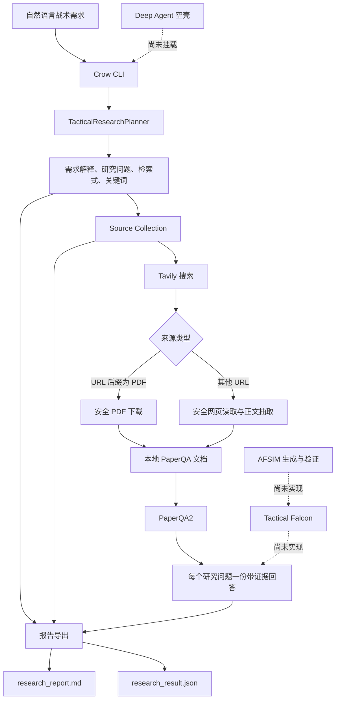

# AFSIM Research Agent 开发交接文档

> 更新日期：2026-10-12  
> 项目版本：0.1.0  
> 项目目录：`/Users/remedios/Desktop/deepagents-main/afsim-research-agent`  
> 当前阶段：Tactical Crow 联网文献检索与证据报告原型

## 1. 当前结论

项目已经跑通一条可独立测试的互联网研究链路：用户输入自然语言战术需求，系统解释需求、生成检索计划，通过 Tavily 搜索并下载网页或 PDF，再由 PaperQA2 基于阿里云模型生成带引用、位置、摘录和相关性评分的研究报告，同时保存完整 JSON 结果。

当前链路适合作为“战术行为模型生成之前的研究层”。它还不能直接生成行为树、处理器驱动模型或 AFSIM 想定，也没有接入 Deep Agents 的工具调用。`knowledge/` 和 `evidence/` 目录目前只有接口意图和占位文件，本地混合检索、来源质量评分、证据去重与冲突合并尚未实现。

现阶段最主要的瓶颈已经从“能否跑通”转为“资料是否足够可靠和完整”。最近一次真实运行成功生成了报告，但仅采集到 2 个来源，另有 3 个来源采集失败，部分问题缺少足够证据。因此下一阶段应先提升联网检索和采集质量，再进入 Tactical Falcon 的行为模型综合。

## 2. 产品目标与边界

长期目标由两条相对独立的开发线路组成：

1. **行为模型线路**：从战术需求出发，研究战术方法，形成可审查的行为规格，随后生成编队、协同、状态转换、行为树或处理器驱动模型，并在 AFSIM 中验证。
2. **物理模型线路**：根据新装备或新机理需求编写 C++ 模型，完成编译、注册、参数校验和仿真验证。

当前仓库只推进第一条线路的前半段，即 Tactical Crow 研究阶段。C++ 物理模型开发应保留独立的构建、测试和验证流程，后续通过统一的需求、证据和仿真验证接口与行为模型线路协同。

### 当前已纳入范围

- 自然语言战术需求解释；
- 研究问题和互联网检索式生成；
- Tavily 互联网检索；
- 网页正文读取与 PDF 下载；
- URL 安全校验、重定向校验和内容大小限制；
- PaperQA2 文献问答和证据摘录；
- Markdown 人工审查报告和 JSON 结构化结果。

### 当前未纳入范围

- 本地知识库的词法、向量和混合检索；
- 确定性的来源质量评分、主张级去重和冲突证据合并；
- Tactical Falcon 战术行为综合；
- 行为树、处理器驱动模型或 AFSIM DSL 生成；
- AFSIM 工程读写、静态验证和闭环仿真；
- C++ 物理模型生成、编译和插件接入。

## 3. 技术框架

| 层次 | 当前选择 | 职责 | 状态 |
| --- | --- | --- | --- |
| Agent 外壳 | Deep Agents `0.7.23` | 后续负责工具编排、任务状态和人工审查入口 | 仅有空壳，尚未挂载工具 |
| 模型访问 | LangChain `ChatOpenAI` + DashScope OpenAI 兼容接口 | 需求规划、PaperQA 摘要和回答 | 已接通 |
| 文献研究 | PaperQA2 `2026.8.12` | 文档解析、嵌入、证据选择、带引用问答 | 已接通 |
| 搜索 | Tavily `0.8.5` | 发现候选网页和 PDF URL | 已实现基础检索 |
| 网页正文 | Requests + Trafilatura `2.3.1` | 安全下载并提取正文 | 已实现 |
| 数据模型 | Pydantic `2.14.0` | 阶段间显式数据契约 | 已实现 |
| 聊天模型 | `qwen3.8-flash` | 当前所有规划和回答任务 | 已验证 |
| 嵌入模型 | `text-embedding-v4`，1024 维 | PaperQA2 文档向量化 | 已验证 |
| 本地模型 | Ollama / `qwen3:14b` / `qwen3-embedding:0.6b` | 早期方案和未来本地检索候选 | 当前主链路未使用 |

Deep Agents 是后续的应用编排框架，PaperQA2 是其中一个领域工具。当前 Crow 流程由普通 Python 类直接编排，尚未把 `research_literature` 包装成 Deep Agent 工具。此时不需要直接编写复杂 LangGraph 图；Deep Agents 本身建立在 LangGraph 能力之上，等工具边界和审核节点稳定后再接入更容易控制。

## 4. 当前总体架构



### 一次运行的数据流

1. `crow.cli` 读取 `.env` 和用户需求，创建带时间戳的运行目录。
2. `TacticalResearchPlanner` 用结构化输出生成 2–4 个研究问题、2–6 个检索式和关键词。
3. `collect_research_sources` 对每个检索式调用 Tavily，按 URL 去重候选结果。
4. 以 `.pdf` 结尾的 URL 进入 PDF 下载器；其他 URL 进入网页正文读取器。
5. 成功来源被转换为本地 `PaperQADocument`；单个来源失败不会终止整次运行。
6. `CrowResearchPipeline` 逐个研究问题调用 PaperQA2。
7. `crow.report` 输出人工可读 Markdown 和无损 JSON。

CLI 明确传入 `local_roots=()`，所以当前命令行测试只使用互联网资料。采集器虽然具备读取本地文件的基础代码，但这不等于已经实现本地知识库混合检索。

## 5. 目录与模块职责

```text
afsim-research-agent/
├── src/afsim_research_agent/
│   ├── agent.py                 Deep Agents 空壳，tools 和 subagents 均为空
│   ├── config.py                环境变量配置
│   ├── models.py                来源、检索结果、证据等共享契约
│   ├── crow/
│   │   ├── cli.py               互联网研究命令行入口
│   │   ├── planner.py           战术需求解释和检索计划
│   │   ├── research.py          计划、采集、PaperQA 的顺序编排
│   │   ├── report.py            Markdown/JSON 报告生成
│   │   └── models.py            Crow 计划与运行结果契约
│   ├── literature/
│   │   ├── collection.py        互联网及基础本地文件采集
│   │   ├── paperqa_backend.py   PaperQA2 的项目适配层
│   │   └── models.py            文档、报告和采集结果契约
│   ├── web/
│   │   ├── search.py            Tavily 适配层
│   │   ├── security.py          公网 URL 校验和 DNS 固定
│   │   ├── reader.py            HTML 下载、正文抽取和标准化
│   │   └── pdf.py               PDF 下载、限流、签名与哈希校验
│   ├── knowledge/               本地混合检索占位目录
│   └── evidence/                质量、去重和冲突合并占位目录
├── tests/unit/                  无网络、可重复的单元测试
├── data/runs/crow-research/     每次真实运行的资料和报告
├── docs/superpowers/specs/      早期总体设计
├── docs/superpowers/plans/      阶段实施计划，不能作为完成状态来源
└── .env.example                 环境变量模板
```

早期 `docs/superpowers/` 文档描述了目标和验收门槛，但其中的待办框没有随实现同步更新。判断完成度时应以本交接文档、实际代码和测试结果为准。

## 6. 核心数据契约

- `TacticalResearchPlan`：需求解释、研究问题、检索式和关键词。
- `SourceCollectionRequest`：本次研究的需求、检索式、可选本地目录和数量限制。
- `SourceCollection`：可用文档、来源记录和采集失败记录。
- `PaperQADocument`：PaperQA2 可读取的本地文件及其引用元数据。
- `PaperQAReport`：一个研究问题的综合回答和证据列表。
- `PaperQAEvidence`：引用、原文摘录、证据摘要、页码或文本位置、相关性评分。
- `CrowResearchResult`：计划、来源采集和所有研究报告组成的完整结果。

共享模型中已经定义 `KnowledgeChunk`、`RetrievalHit`、`Evidence` 和 `EvidenceBundle`，但目前没有对应实现。后续应尽量保持这些项目自有契约，让第三方库只存在于适配层内。

## 7. 环境配置

当前已验证环境：

- macOS，Apple M5，24 GB 内存；
- Conda 环境：`afsim_agent`；
- Python：`3.12.15`；
- `deepagents==0.7.23`；
- `langchain-openai==1.7.0`；
- `paper-qa==2026.8.12`；
- `pydantic==2.14.0`；
- `tavily-python==0.8.5`；
- `trafilatura==2.3.1`。

在项目根目录创建 `.env`：

```dotenv
DASHSCOPE_API_KEY=填入阿里云百炼_API_Key
DASHSCOPE_BASE_URL=https://dashscope.aliyuncs.com/compatible-mode/v1
DASHSCOPE_CHAT_MODEL=qwen3.8-flash
DASHSCOPE_EMBEDDING_MODEL=text-embedding-v4

PAPERQA_EMBEDDING_DIMENSION=1024
PAPERQA_DISABLE_THINKING=true
PAPERQA_EVIDENCE_K=5
PAPERQA_MAX_SOURCES=3
PAPERQA_CONCURRENCY=1

TAVILY_API_KEY=填入_Tavily_API_Key
AFSIM_RESEARCH_DATA_DIR=./data
```

`.env` 已被 `.gitignore` 排除，禁止把真实密钥写入代码、文档或提交记录。此前调试输出曾暴露过一个完整 API Key；若尚未处理，必须在阿里云控制台作废并重新创建。

`load_dotenv()` 默认不会覆盖 shell 中已有的环境变量。如果终端曾导出旧的 `DASHSCOPE_API_KEY`，它会优先于 `.env`。运行前执行 `unset DASHSCOPE_API_KEY` 可以避免使用旧值。

## 8. 手动运行

```bash
cd /Users/remedios/Desktop/deepagents-main/afsim-research-agent
conda activate afsim_agent
unset DASHSCOPE_API_KEY

LITELLM_LOCAL_MODEL_COST_MAP=True \
python -m afsim_research_agent.crow.cli \
  --requirement "研究装甲车在不同地形情况下的编队方式" \
  --max-web-results 1
```

`--max-web-results` 是每个检索式的上限，而不是整次运行的总上限。例如规划器产生 5 个检索式且参数为 1，最多会尝试 5 个去重后的 URL。

每次运行写入：

```text
data/runs/crow-research/<timestamp>/
├── pdf/                    下载成功的 PDF
├── web/                    提取后的网页 Markdown
├── research_report.md      人工审查报告
└── research_result.json    完整结构化结果
```

LiteLLM 可能输出“无法计算 `qwen3.8-flash` 成本”的警告。这表示本地价格表没有该模型的计价信息，不代表模型调用失败。`LITELLM_LOCAL_MODEL_COST_MAP=True` 可避免尝试从 GitHub 下载价格表时产生证书告警，但不会补全价格数据。

## 9. 最近一次真实运行

最近验证的用户运行目录：

```text
data/runs/crow-research/20261012-210420
```

运行结果：

| 指标 | 数量 |
| --- | ---: |
| 研究问题 | 4 |
| 检索式 | 5 |
| 成功来源 | 2 |
| 采集失败 | 3 |
| PaperQA 报告 | 4 |
| 证据条目 | 12 |

成功来源包括一篇 `TACTICAL CONVOY OPS` 手册 PDF 和一篇军事车辆相关文章。YouTube、Wikimedia PDF 和 Army University 网页采集失败。流程完整结束并生成 Markdown 和 JSON，但部分回答明确表示资料不足，个别证据相关性只有 `2/10`。

这里的 `0–10` 分数是 PaperQA2 对当前问题的证据上下文相关性评分，不是来源权威性、可信度或方法质量评分。真正的来源质量评分尚未开发。

## 10. 已完成验证

最后一次完整代码验证结果：

- `pytest`：54 个测试通过，5 个第三方 SWIG 弃用警告；
- `ruff check src tests`：通过；
- 阿里云 `text-embedding-v4` 实际调用：返回 1024 维有限数值向量；
- Tactical Crow 真实联网运行：成功生成计划、来源、4 份问答报告及两种输出文件。

单元测试不访问外网，覆盖 CLI、规划器、报告、编排器、来源采集、PaperQA 适配、PDF、网页读取、搜索和 URL 安全。真实云端调用属于手动冒烟测试，目前没有自动集成测试。

常用验证命令：

```bash
conda run -n afsim_agent pytest -q
conda run -n afsim_agent ruff check src tests
conda run -n afsim_agent python -m pip check
```

## 11. 已知问题与技术债

### 11.1 检索与采集质量

- Tavily 当前使用 `basic` 搜索，没有域名约束、论文元数据解析、年份过滤或来源类型优先级。
- 仅通过 URL 路径是否以 `.pdf` 结尾判断 PDF。下载接口、无后缀 PDF 和带特殊路径的 PDF 可能被当成网页读取并失败。
- 不支持需要 JavaScript、登录、验证码、视频转录或特殊证书的网站。
- 采集失败统一记录为 `source collection failed`，丢失了 HTTP 状态、内容类型、超限、DNS、安全拒绝等具体原因。
- 当前结果只保留成功来源和失败 URL，没有完整保存所有原始搜索候选、去重决策和拒绝原因。
- 网页采集只保存提取后的 Markdown；采集器没有向 `read_webpage` 传入 `raw_dir`，因此没有保存原始 HTML 快照，与早期“保留原始证据”的设计目标仍有差距。

### 11.2 PaperQA 性能与成本

- `CrowResearchPipeline` 对每个研究问题调用一次 `PaperQABackend.query`。
- `PaperQABackend.query` 每次都会新建 `Docs` 并重新添加全部文档。
- 一次运行有 4 个研究问题时，同一批文档可能被解析和嵌入 4 次，增加耗时和 API 成本。
- LiteLLM 本地价格表不知道 `qwen3.8-flash`，当前无法从日志得到可靠的调用费用。

应把“一次运行建立一个文档语料库、对多个问题复用该语料库”作为近期重构目标，同时保持现有项目自有报告结构不变。

### 11.3 证据与可重复性

- `evidence/quality.py`、`deduplicate.py` 和 `merge.py` 只有文档字符串，没有实现。
- 目前只有 URL 级去重，没有内容哈希级镜像识别和主张级重复检测。
- 没有明确区分支持证据、冲突证据、推断和未知项。
- JSON 结果没有记录模型版本、关键运行参数、提示词版本、耗时和依赖版本，严格复现实验仍不充分。

### 11.4 Agent 和行为模型

- `agent.py` 的 `tools=[]`、`subagents=[]`，Crow 尚未包装成 `research_literature` 工具。
- 没有 Tactical Falcon，也没有从研究报告到行为模型的稳定中间表示。
- 没有行为树、处理器驱动行为或 AFSIM 配置生成器。
- 没有仿真结果回读、参数迭代和人工验证报告。

### 11.5 工程管理

当前项目目录不在 Git 仓库中，无法可靠查看历史、回滚变更或进行代码评审。这与“全开发流程可控”的目标不一致。开始下一阶段开发前，应把该项目初始化为独立 Git 仓库或纳入明确的父仓库，并提交一个不含 `.env` 和 `data/runs/` 的基线版本。

## 12. 下一阶段建议

### P0：先让当前 Crow 可诊断、可复现

1. 建立 Git 基线并确认密钥已经轮换。
2. 保留具体采集异常类别和简化后的错误信息。
3. 保存原始搜索候选、采集决策、运行配置和模型标识。
4. 一次构建 PaperQA 文档库，复用它回答全部研究问题。
5. 为真实运行增加独立的、默认不执行的冒烟测试脚本。

完成标准：同一需求重复运行时，开发者可以解释每个 URL 为什么被接受或拒绝，也可以确认同一批文档只嵌入一次。

### P1：提升联网文献质量

1. 增加学术和官方来源偏好，包括 DOI、作者、机构、发布时间和文档类型元数据。
2. 为检索式增加同义词、领域术语、官方手册和论文定向查询。
3. 支持通过响应头和内容签名识别 PDF，而不是只看 URL 后缀。
4. 实现确定性的来源质量评分；与 PaperQA 相关性评分分开保存。
5. 按 URL、内容哈希和主张三级去重，并显式保留冲突证据。
6. 设定进入 Falcon 的最低证据门槛，例如权威来源数量、关键问题覆盖率和未解决项比例。

完成标准：报告能回答“资料从哪里来、为什么可信、哪些来源相互支持或冲突、哪些参数仍未知”。

### P2：建立 Tactical Crow 到 Tactical Falcon 的契约

建议新增项目自有的 `TacticalBehaviorSpec` 中间表示，至少包含：

- 场景和参与方；
- 任务目标和战术意图；
- 状态、事件、触发条件和终止条件；
- 单平台动作与多平台协调关系；
- 通信、感知、武器和机动约束；
- 可配置参数、单位、取值范围和默认值；
- 每条规则对应的证据引用；
- 推断、冲突和待人工确认项；
- 可执行验证场景和预期观察结果。

Crow 只输出证据充分的研究包；Falcon 把研究包转为 `TacticalBehaviorSpec`。在人工审查通过之前，不直接生成 AFSIM 行为代码。

### P3：接入 Deep Agents

将完整 Crow 流程封装为一个窄接口工具，例如：

```text
research_literature(requirement, limits) -> CrowResearchResult
```

Deep Agent 负责理解用户意图、调用工具、展示审核点和管理后续 Falcon 任务。搜索、下载、安全、质量评分和证据合并仍由确定性代码负责，不交给模型自由决定。

### P4：按用户节奏补充本地知识库

用户当前要求优先完成互联网文献研究，因此本地 RAG 可以后置。实现时沿用早期设计：稳定分块、SQLite FTS5 词法召回、专用嵌入模型语义召回、RRF 融合，以及固定评测查询集。不要把“遍历本地文件后直接交给 PaperQA”当成混合检索完成。

### P5：生成和验证 AFSIM 行为模型

在 `TacticalBehaviorSpec` 稳定后，再增加行为树或处理器驱动模型渲染器、静态检查、证据追踪、人工验证清单和仿真闭环。C++ 物理模型扩展建立独立流水线，通过清晰接口与行为模型共享参数和验证场景。

## 13. 接手开发约束

- LLM 负责需求解释、检索计划和基于证据的综合；抓取策略、边界限制、来源评分、去重和冲突规则由代码控制。
- 任何生成的战术规则都必须能追溯到具体来源和位置；推断必须显式标注。
- 搜索摘要只能用于发现来源，不能直接作为最终证据。
- 单个来源失败不得终止整个研究任务，但必须保留可诊断原因。
- 真实 API 测试需要显式运行，单元测试保持无网络、低成本和可重复。
- 先保持单 Agent、单工具链。只有出现明确、可独立验证的职责时再增加子 Agent。
- 每个阶段都应产生人工可读报告和机器可读结果，并在进入下一阶段前设置审核点。

## 14. 交接检查清单

- [ ] 确认阿里云和 Tavily 密钥可用，且未出现在代码或文档中。
- [ ] 若旧阿里云密钥尚未作废，立即轮换。
- [ ] 在 `afsim_agent` 环境运行完整测试、Ruff 和 `pip check`。
- [ ] 用一个低结果数需求完成真实冒烟测试，并检查 Markdown 与 JSON。
- [ ] 建立 Git 基线。
- [ ] 优先处理 PaperQA 文档复用和采集失败可诊断性。
- [ ] 实现来源质量和证据合并后，再定义 Falcon 的输入门槛。
- [ ] 本地混合检索按用户后续优先级启动。
- [ ] Falcon 输出先落到 `TacticalBehaviorSpec`，经人工审查后再生成 AFSIM 模型。

