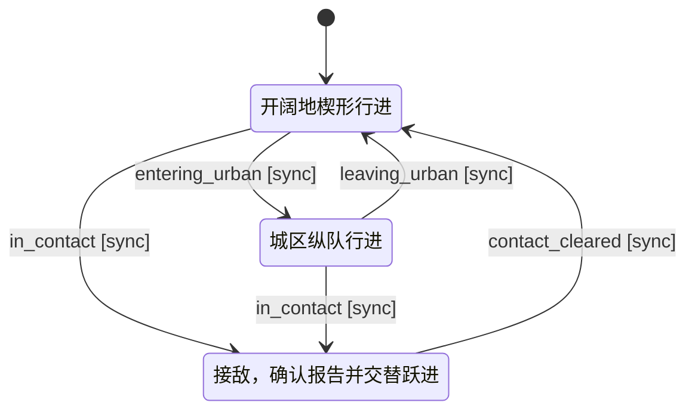
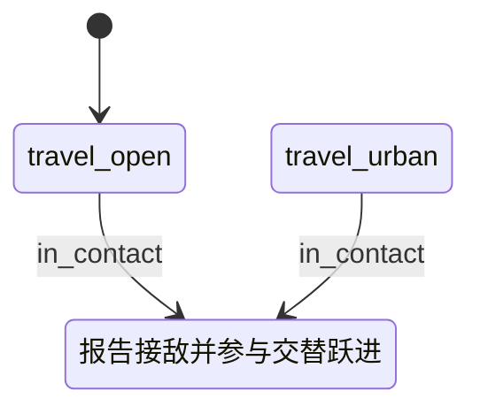

# 战术稿：装甲排地形自适应编队（示例）

Falcon v2 的战术稿示例：与 `behavior_spec.yaml` 表达同一个模型。
`python -m afsim_research_agent.falcon compile <模型包>` 可把战术稿编译成 IR。

```yaml model
model:
  display_name: 装甲排地形自适应编队（示例）
  description: 装甲排沿路线机动，开阔地用楔形、接近城区转纵队；接敌时报告并转入交替跃进。
  intent: formation_transition
  concepts: [unit.tank_platoon, formation.wedge, formation.column, movement.techniques, terrain.urban]
roles:
  platoon_leader:
    count: 1
    platform: ground_vehicle
    description: 排长车
    sensors: {vehicle_sight: visual_search}
    comms: {platoon_net: voice_data}
  wingman:
    count: 3
    platform: ground_vehicle
    description: 僚车（3 辆）
    superior: platoon_leader
    sensors: {vehicle_sight: visual_search}
    comms: {platoon_net: voice_data}
parameters:
  wedge_depth: {value: 100 m, range: [25 m, 500 m], basis: user_specified, description: 楔形纵深间隔（示例值）}
  wedge_half_width: {value: 100 m, range: [25 m, 500 m], basis: user_specified, description: 楔形横向半宽（示例值）}
  column_interval: {value: 50 m, range: [10 m, 300 m], basis: user_specified, description: 纵队车间距（示例值）}
  station_tolerance: {value: 30 m, basis: user_specified, description: 站位容差（示例值）}
  urban_transition_distance: {value: 200 m, basis: user_specified, description: 距城区多远开始转纵队（示例值）}
  contact_range: {value: 1.5 km, basis: user_specified, description: 视为接敌的距离（示例值）}
  contact_hold_time: {value: 2 min, basis: user_specified, description: 失去接触后保持接敌状态的时间（示例值）}
  travel_speed_open: {value: 30 km/h, basis: user_specified, description: 开阔地行进速度（示例值）}
  travel_speed_urban: {value: 15 km/h, basis: user_specified, description: 城区行进速度（示例值）}
  bound_distance: {value: 300 m, basis: user_specified, description: 每次跃进距离（示例值）}
  standoff_distance: {value: 800 m, basis: user_specified, description: 交替跃进停止推进的对敌距离（示例值）}
formations:
  wedge:
    description: 楔形：两翼在长车后侧，第三车居中殿后
    slots:
      "wingman[0]": {forward: -1 * wedge_depth, right: -1 * wedge_half_width}
      "wingman[1]": {forward: -wedge_depth, right: wedge_half_width}
      "wingman[2]": {forward: -2 * wedge_depth, right: 0 m}
    tolerance: station_tolerance
    basis: user_specified
  column:
    description: 纵队：依次跟随长车
    slots:
      "wingman[0]": {forward: -1 * column_interval, right: 0 m}
      "wingman[1]": {forward: -2 * column_interval, right: 0 m}
      "wingman[2]": {forward: -3 * column_interval, right: 0 m}
    tolerance: station_tolerance
    basis: user_specified
coordination:
  coord_leader_follower:
    pattern: leader_follower
    leader: platoon_leader
    followers: wingman
    formations: {travel_open: wedge, travel_urban: column}  # 长车处于该状态时全排用的编队
    basis: user_specified
  coord_bounding:
    pattern: bounding_overwatch
    bounding: [platoon_leader, "wingman[2]"]
    overwatch: ["wingman[0]", "wingman[1]"]
    bound_distance: bound_distance
    standoff: standoff_distance
    active_when: in_contact
    basis: user_specified
  coord_contact_report:
    pattern: report_and_wait
    reporter: wingman
    receiver: platoon_leader
    ack_timeout: 30 s
    basis: user_specified
assumptions:
  comms:
    statement: 排内所有车辆具备可用的语音/数据通信。
    affects: [coord_leader_follower, coord_contact_report]
implements:
  rq_01: [wedge, platoon_leader.travel_open, "platoon_leader: travel_open -> travel_urban"]
  rq_02: ["platoon_leader: travel_open -> travel_urban", coord_leader_follower, column]
  rq_03: [column_interval, column]
  rq_04: [coord_contact_report, wingman.contact]
  rq_05: [coord_bounding]
  rq_06: [standoff_distance, coord_bounding]
```





```python conditions
in_contact = track.nearest_hostile_range <= contact_range  # 最近敌方目标进入接敌距离
entering_urban = terrain.distance_to_class("urban") <= urban_transition_distance  # 前方城区已在转换距离内
leaving_urban = not entering_urban and terrain.class != "urban"  # 已离开城区
contact_cleared = not in_contact and time_in_state() >= contact_hold_time  # 接敌解除并保持一段时间
```

```python platoon_leader
def travel_open():
    # 开阔地沿路线行进（楔形：由 formations 生成编队写入与通报）
    with sequence(name="leader_open_root"):
        FollowRoute(name="leader_move_open", route="main_route", speed=travel_speed_open)

def travel_urban():
    # 城区降速（纵队：由 formations 生成）
    with sequence(name="leader_urban_root"):
        FollowRoute(name="leader_move_urban", route="main_route", speed=travel_speed_urban)

def contact():
    # 收到报告先确认，否则组织交替掩护
    with reactive_fallback(name="leader_contact_root"):
        with reactive(name="leader_ack_seq"):
            assert coord_contact_report.report_received
            coord_contact_report.acknowledge(name="leader_ack")
        coord_bounding.tree(name="leader_bounding")
```

```python wingman
def travel_open():
    coord_leader_follower.keep_station(name="wingman_keep_station")

def travel_urban():
    coord_leader_follower.keep_station()

def contact():
    # 每次接敌报告一次，然后参加交替掩护
    with once():
        coord_contact_report.send_report()
    coord_bounding.tree(name="wingman_bounding")
```

```yaml basis
platoon_leader:
  travel_open -> contact: user_specified
  travel_open -> travel_urban: user_specified
  travel_urban -> contact: user_specified
  travel_urban -> travel_open: user_specified
  contact -> travel_open: user_specified
wingman:
  travel_open -> contact: user_specified
  travel_urban -> contact: user_specified
```

```yaml verification
tests:
  - id: leader_travels_in_wedge
    category: nominal
    role: platoon_leader
    state: travel_open
    expect: {next_state: travel_open, actions: [SendMessage, FollowRoute]}
  - id: leader_switches_to_column_near_urban
    category: nominal
    role: platoon_leader
    state: travel_open
    given: {terrain: {distance_to_class.urban: 150 m}}
    expect: {next_state: travel_urban, transition: travel_open -> travel_urban}
  - id: leader_returns_to_open
    category: nominal
    role: platoon_leader
    state: travel_urban
    given: {terrain: {class: open}}
    expect: {next_state: travel_open, transition: travel_urban -> travel_open}
  - id: leader_contact_preempts_urban_entry
    category: priority_transition
    role: platoon_leader
    state: travel_open
    given: {terrain: {distance_to_class.urban: 150 m}, tracks: {nearest_hostile_range: 1 km}}
    expect: {next_state: contact, transition: travel_open -> contact, actions: [BoundToPosition]}
  - id: leader_contact_in_urban
    category: priority_transition
    role: platoon_leader
    state: travel_urban
    given: {terrain: {class: urban, distance_to_class.urban: 0}, tracks: {nearest_hostile_range: 800 m}}
    expect: {next_state: contact, transition: travel_urban -> contact}
  - id: leader_leaves_contact_after_hold
    category: timeout_or_loss
    role: platoon_leader
    state: contact
    given: {elapsed: {state: 3 min}}
    expect: {next_state: travel_open, transition: contact -> travel_open}
  - id: leader_cannot_move_without_mover
    category: resource_unavailable
    role: platoon_leader
    state: travel_open
    given: {components: {mover.available: false}}
    expect: {next_state: travel_open, status: failure}
  - id: wingman_follows_leader_transition
    category: nominal
    role: wingman
    instance: 1
    state: travel_open
    given: {messages: [{coord_leader_follower.transition: {to_state: travel_urban}}]}
    expect: {next_state: travel_urban, transition: travel_open -> travel_urban}
  - id: wingman_reports_contact
    category: priority_transition
    role: wingman
    state: travel_open
    given: {tracks: {nearest_hostile_range: 1.2 km, hostile_count: 1}}
    expect: {next_state: contact, transition: travel_open -> contact, actions: [ReportContact], messages: [coord_contact_report.report]}
  - id: wingman_urban_contact
    category: priority_transition
    role: wingman
    instance: 2
    state: travel_urban
    given: {tracks: {nearest_hostile_range: 500 m}}
    expect: {next_state: contact, transition: travel_urban -> contact}
  - id: bounding_stops_at_standoff
    category: precondition_failure
    role: wingman
    instance: 2
    state: contact
    given: {tracks: {nearest_hostile_range: 805 m}}
    expect: {next_state: contact, actions: [HoldOverwatchPosition]}
scenarios:
  - id: open_to_urban_transition
    description: 开阔地行进约 2 km 后接近城区，期望全排转为纵队并保持站位。
    route: [[0, 0], [5000, 0]]
    terrain: {default: open, regions: [{class: urban, x: [2500, 4000], y: [-1500, 1500]}]}
    duration: 8 min
    seed: 42
    events:
      - {id: leader_near_urban, type: marker, when: {role: platoon_leader, x_gte: 2300}}
    expect:
      - {id: e_followers_switch, observable: role_state, role: wingman, equals: travel_urban, within: {after: leader_near_urban, time: 30 s}}
      - {id: e_wedge_kept, observable: formation_error_rms, formation: wedge, lte: station_tolerance, during: {from: start, for: 150 s}}
      - {id: e_column_kept, observable: formation_error_rms, formation: column, lte: station_tolerance, during: {from: e_followers_switch, for: 120 s}}
      - {id: e_no_collisions, observable: min_interval, role: wingman, gte: 10 m}
  - id: contact_bounding_overwatch
    description: 开阔地遭遇敌方，期望报告接敌、全排转入接敌状态并交替跃进。
    route: [[0, 0], [6000, 0]]
    duration: 10 min
    seed: 7
    events:
      - {id: hostile_appears, type: spawn_hostile, at: 60 s, position: [2600, 300]}
    expect:
      - {id: e_leader_contact, observable: role_state, role: platoon_leader, equals: contact, within: {after: hostile_appears, time: 120 s}}
      - {id: e_report_sent, observable: messages_sent, message: coord_contact_report.report, gte: 1}
      - {id: e_bounds_alternate, observable: messages_sent, message: coord_bounding.bound_complete, gte: 4}
      - {id: e_standoff_kept, observable: hostile_range_min, gte: 775 m}
    traces_to: [coord_bounding]
  - id: partial_comm_loss_transition
    description: 通信丢包 50% 时长车转纵队，僚车仍应在进入城区前完成同步。
    route: [[0, 0], [5000, 0]]
    terrain: {default: open, regions: [{class: urban, x: [2500, 4000], y: [-1500, 1500]}]}
    duration: 8 min
    seed: 11
    events:
      - {id: lossy_net, type: comm_degradation, at: 0 s, duration: 8 min, loss: 0.5}
      - {id: leader_near_urban, type: marker, when: {role: platoon_leader, x_gte: 2300}}
    expect:
      - {id: e_followers_switch_lossy, observable: role_state, role: wingman, equals: travel_urban, within: {after: leader_near_urban, time: 45 s}}
```
