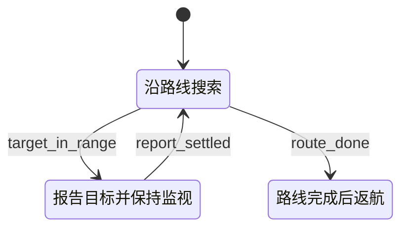
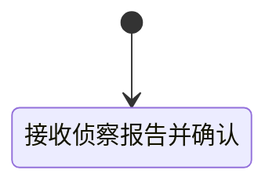

# 战术稿：无人机路线侦察与地面站报告（示例）

与装甲排示例完全不同的任务，用来检验 Falcon v2 的通用性：两架无人机沿路线侦察，
发现目标后向地面站报告并盘旋监视，收到确认（或超时）后继续搜索，走完路线后返航。

```yaml model
model:
  display_name: 无人机路线侦察（示例）
  description: 两架侦察无人机沿预定路线搜索，发现目标即向地面站报告并保持监视，确认后继续搜索，路线完成后返航。
  intent: route_reconnaissance
  concepts: [unit.reconnaissance, coop.communication, model.state_machine, model.behavior_tree]
roles:
  scout:
    count: 2
    platform: air_vehicle
    description: 侦察无人机
    sensors: {eo_camera: visual_search}
    comms: {uplink: data_link}
  ground_station:
    count: 1
    platform: static_node
    mover: false
    description: 地面控制站
    comms: {uplink: data_link}
parameters:
  search_speed: {value: 120 km/h, range: [60 km/h, 200 km/h], basis: unknown, rationale: 小型侦察无人机常见巡航速度的参考值}
  detect_range: {value: 3 km, range: [1 km, 8 km], basis: unknown, rationale: 光电载荷对车辆目标的参考识别距离}
  watch_time: {value: 2 min, range: [30 s, 10 min], basis: unknown, rationale: 发现目标后保持监视的参考时长}
coordination:
  sighting_report:
    pattern: report_and_wait
    reporter: scout
    receiver: ground_station
    ack_timeout: 30 s
    basis: unknown
implements:
  rq_01: [scout, "scout.search"]
  rq_02: ["scout: search -> watch", detect_range]
  rq_03: [sighting_report, "ground_station.listen"]
  rq_04: ["scout: watch -> search", watch_time]
  rq_05: ["scout: search -> return_home", search_speed]
  rq_06: [ground_station]
```





```python conditions
target_in_range = track.hostile_count > 0 and track.nearest_hostile_range <= detect_range  # 发现目标
route_done = mover.route_complete  # 侦察路线走完
report_settled = sighting_report.ack_received or time_in_state() >= watch_time  # 已确认或监视时间到
```

```python scout
def search():
    FollowRoute(name="scout_search_route", route="main_route", speed=search_speed)

def watch():
    with sequence(name="scout_watch_root"):
        with once():  # 每次发现目标报告一次
            sighting_report.send_report()
        Halt()

def return_home():
    MoveToPosition(name="scout_return", position="home", speed=search_speed)
```

```python ground_station
def listen():
    if sighting_report.report_received:
        sighting_report.acknowledge(name="station_ack")
```

```yaml basis
scout:
  search -> watch: {status: unknown}
  search -> return_home: {status: unknown}
  watch -> search: {status: unknown}
```

```yaml verification
tests:
  - id: scout_spots_target
    category: nominal
    role: scout
    state: search
    given: {tracks: {hostile_count: 1, nearest_hostile_range: 2 km}}
    expect: {next_state: watch, transition: search -> watch}
  - id: scout_ignores_far_target
    category: precondition_failure
    role: scout
    state: search
    given: {tracks: {hostile_count: 1, nearest_hostile_range: 6 km}}
    expect: {next_state: search}
  - id: target_before_route_end
    category: priority_transition
    role: scout
    state: search
    given: {tracks: {hostile_count: 1, nearest_hostile_range: 1 km}, components: {mover.route_complete: true}}
    expect: {next_state: watch, transition: search -> watch}
  - id: scout_returns_at_route_end
    category: nominal
    role: scout
    state: search
    given: {components: {mover.route_complete: true}}
    expect: {next_state: return_home, transition: search -> return_home}
  - id: ack_resumes_search
    category: nominal
    role: scout
    state: watch
    given: {messages: [{sighting_report.ack: {}}]}
    expect: {next_state: search, transition: watch -> search}
  - id: no_ack_watch_times_out
    category: timeout_or_loss
    role: scout
    state: watch
    given: {elapsed: {state: 3 min}}
    expect: {next_state: search, transition: watch -> search}
  - id: scout_without_mover_stays
    category: resource_unavailable
    role: scout
    state: search
    given: {components: {mover.available: false}}
    expect: {next_state: search}
  - id: station_listens
    category: nominal
    role: ground_station
    state: listen
    given: {messages: [{sighting_report.report: {}}]}
    expect: {next_state: listen}
scenarios:
  - id: recon_with_sighting
    description: 侦察途中出现目标，期望无人机报告并转入监视，之后继续搜索。
    route: [[0, 0], [20000, 0]]
    duration: 10 min
    seed: 3
    events:
      - {id: target_appears, type: spawn_hostile, at: 120 s, position: [6000, 500]}
    expect:
      - {id: e_watch, observable: role_state, role: scout, equals: watch, within: {after: target_appears, time: 90 s}}
      - {id: e_report, observable: messages_sent, message: sighting_report.report, gte: 1}
  - id: recon_with_link_loss
    description: 数据链丢包 50% 时出现目标，期望无人机仍转入监视，并在超时后继续搜索。
    route: [[0, 0], [20000, 0]]
    duration: 10 min
    seed: 5
    events:
      - {id: link_loss, type: comm_degradation, at: 0 s, duration: 10 min, loss: 0.5}
      - {id: target_appears, type: spawn_hostile, at: 120 s, position: [6000, 500]}
    expect:
      - {id: e_watch_lossy, observable: role_state, role: scout, equals: watch, within: {after: target_appears, time: 90 s}}
```
